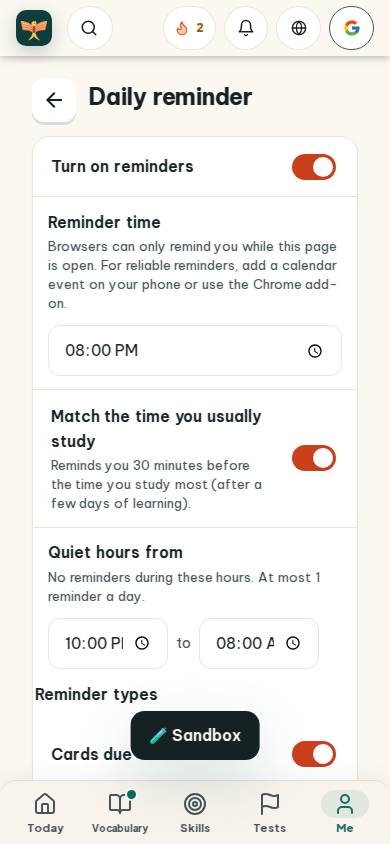
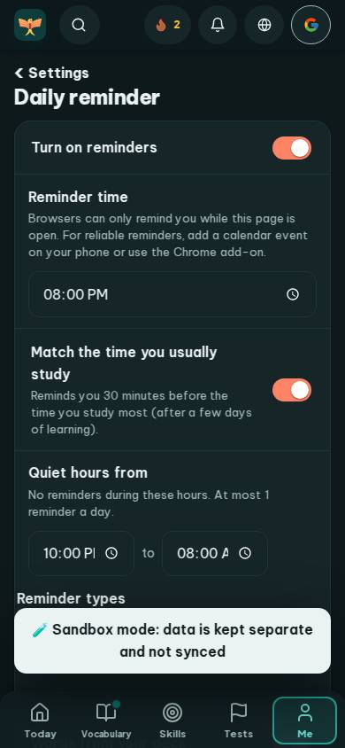
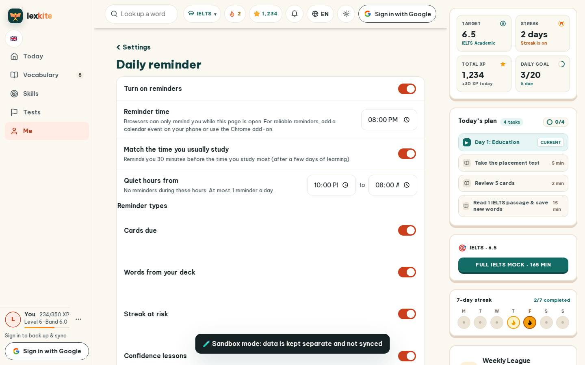
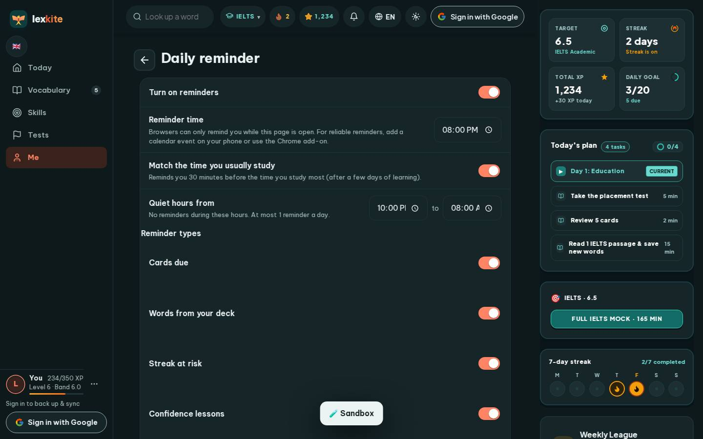

# #/settings/remind

Điểm: **92** · độ phủ 100 % · /settings/remind

- Chức năng: 100
- Lỗi JS: 100
- Rỗng/lỗi/tải: 100
- Back/Thoát: –
- Tương phản: 100
- Chạm ≥44: 100
- Bố cục: 100
- i18n 15: 100
- Hiệu năng: 59
- Độ đẹp: 72

## Lỗi
- [perf] LCP 5372 ms · CLS 0.0039 · TBT 52 ms
- [beauty] Generic system font lacks Duolingo's playful character
- [beauty] Dark toast banner feels abrupt and unpolished
- [beauty] Flat icons and toggles look standard, not custom-branded

## Ảnh
390l 
390d 
1440l 
1440d 
