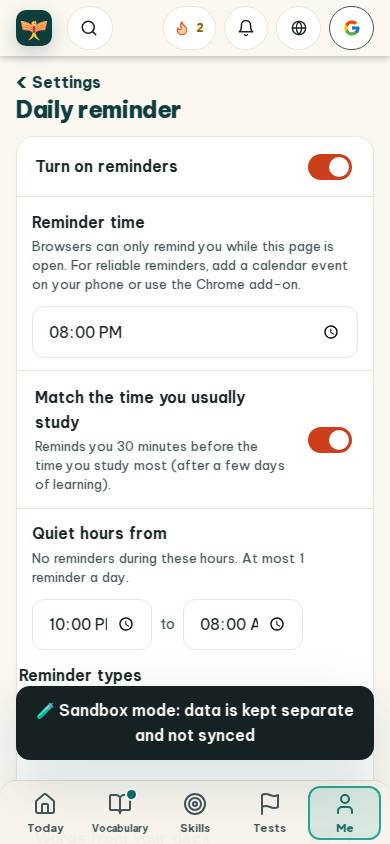
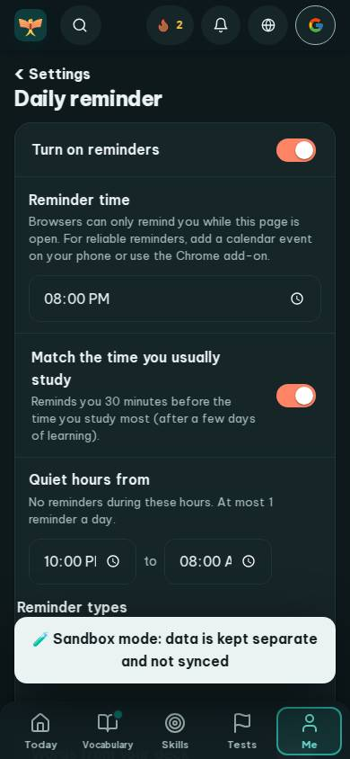
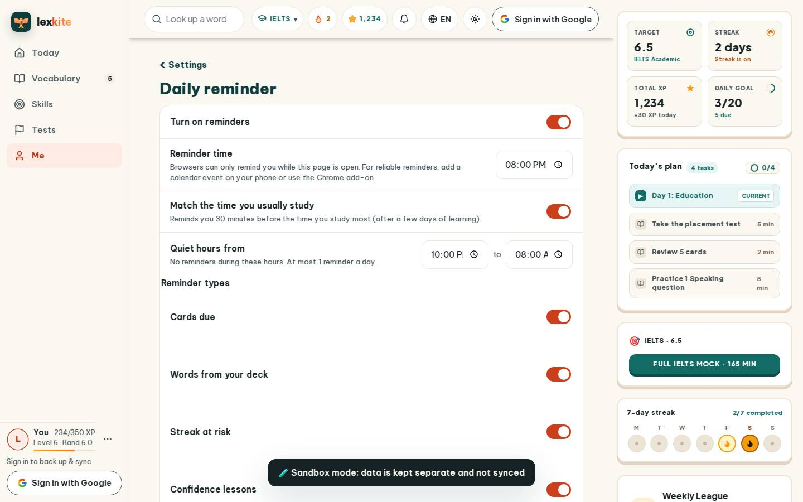
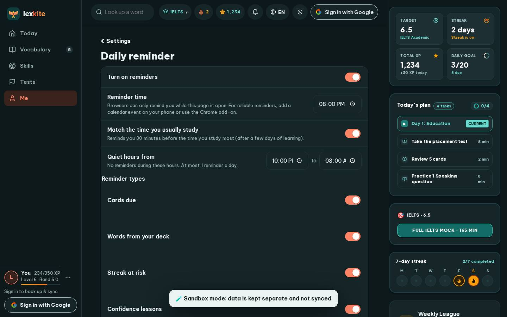

# #/settings/remind

Điểm: **93** · độ phủ 100 % · /settings/remind

- Chức năng: 100
- Lỗi JS: 100
- Rỗng/lỗi/tải: 100
- Back/Thoát: –
- Tương phản: 100
- Chạm ≥44: 100
- Bố cục: 100
- i18n 15: 100
- Hiệu năng: 58
- Độ đẹp: 77

## Lỗi
- [perf] LCP 5444 ms · CLS 0.0031 · TBT 105 ms
- [beauty] Time inputs show truncated text (e.g., '10:00 PI')
- [beauty] Dark 'Sandbox mode' banner feels like a raw debug overlay
- [beauty] Generic utility styling lacks Duolingo's playful character integration

## Ảnh
390l 
390d 
1440l 
1440d 
