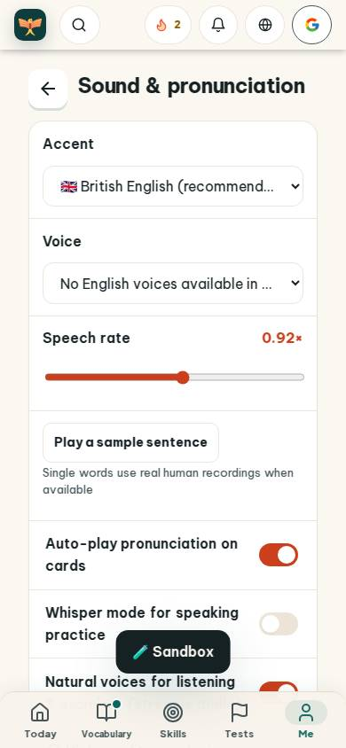
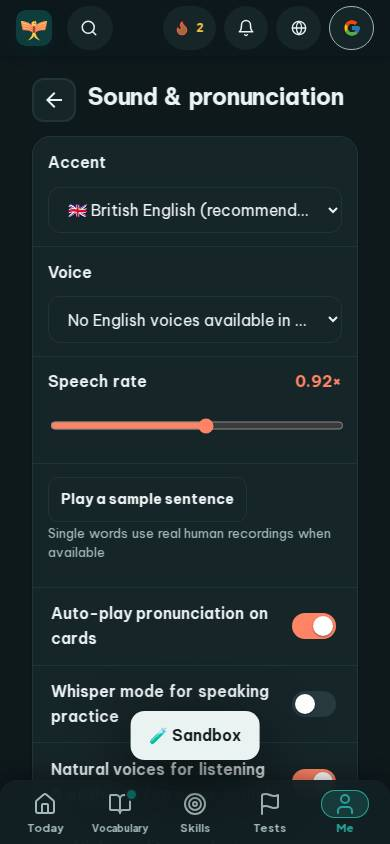
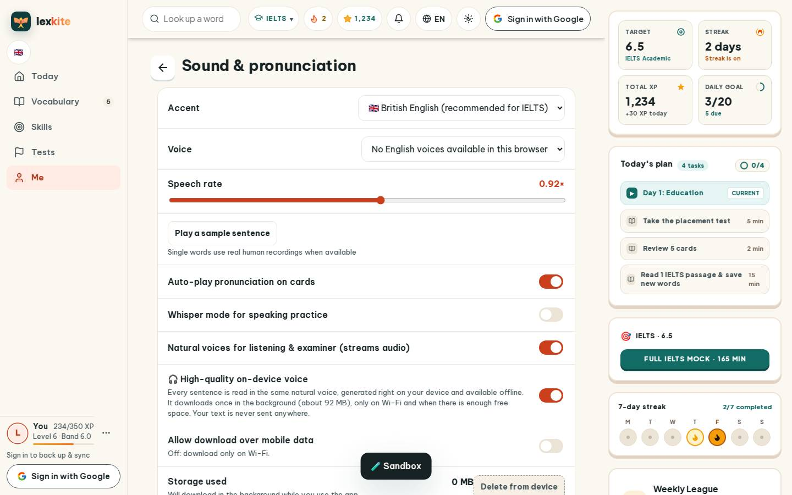
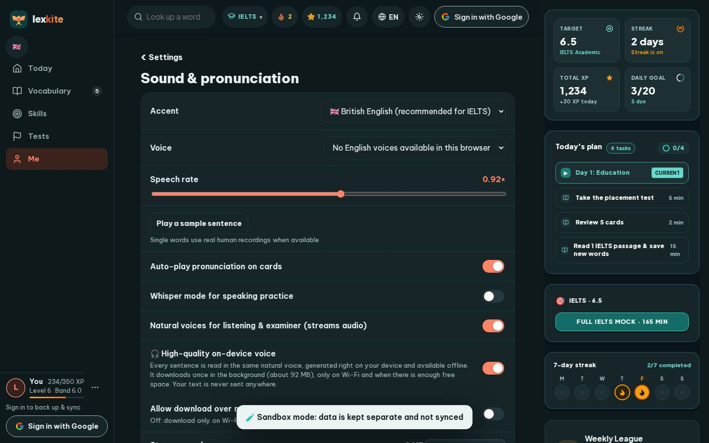

# #/settings/sound

Điểm: **95** · độ phủ 100 % · /settings/sound

- Chức năng: 100
- Lỗi JS: 100
- Rỗng/lỗi/tải: 100
- Back/Thoát: –
- Tương phản: 100
- Chạm ≥44: 100
- Bố cục: 100
- i18n 15: 100
- Hiệu năng: 83
- Độ đẹp: 75

## Lỗi
- [perf] LCP 3720 ms · CLS 0.0182 · TBT 170 ms
- [beauty] Toast notification obscures content and bottom nav
- [beauty] Generic native-looking dropdowns lack app polish
- [beauty] No character/illustration integration; feels like a form

## Ảnh
390l 
390d 
1440l 
1440d 
