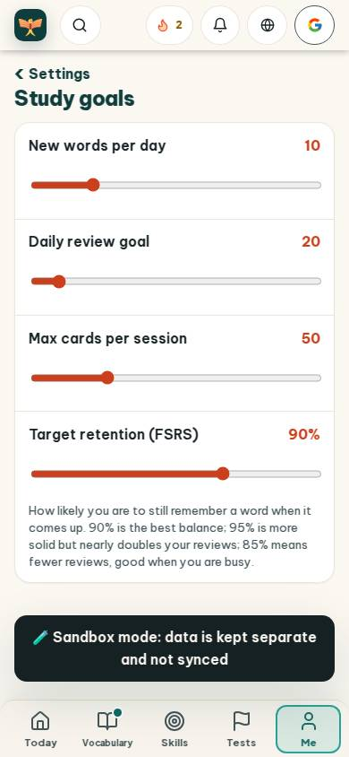
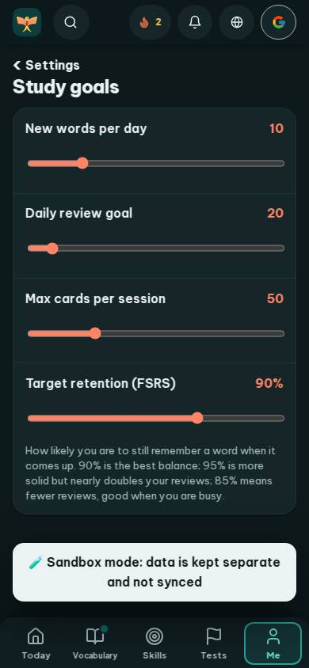
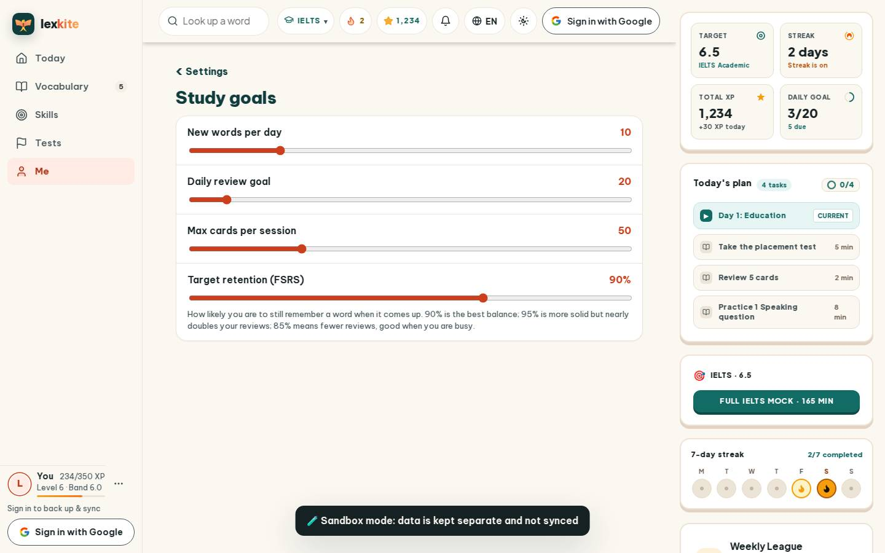
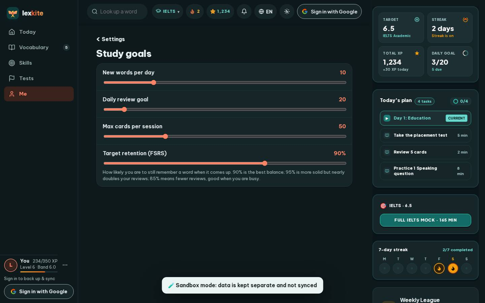

# #/settings/study

Điểm: **93** · độ phủ 100 % · /settings/study

- Chức năng: 100
- Lỗi JS: 100
- Rỗng/lỗi/tải: 100
- Back/Thoát: –
- Tương phản: 90
- Chạm ≥44: 100
- Bố cục: 100
- i18n 15: 100
- Hiệu năng: 56
- Độ đẹp: 84

## Lỗi
- [contrast] a[data-ext-cta="rail"]
- [perf] LCP 5464 ms · CLS 0.0031 · TBT 260 ms
- [beauty] Generic system sliders lack Duolingo's playful custom styling.
- [beauty] Dense explanatory text block feels utilitarian, not character-driven.
- [beauty] Top nav icons feel cramped and visually noisy.

## Ảnh
390l 
390d 
1440l 
1440d 
