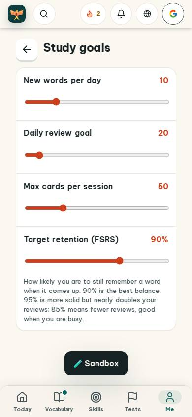
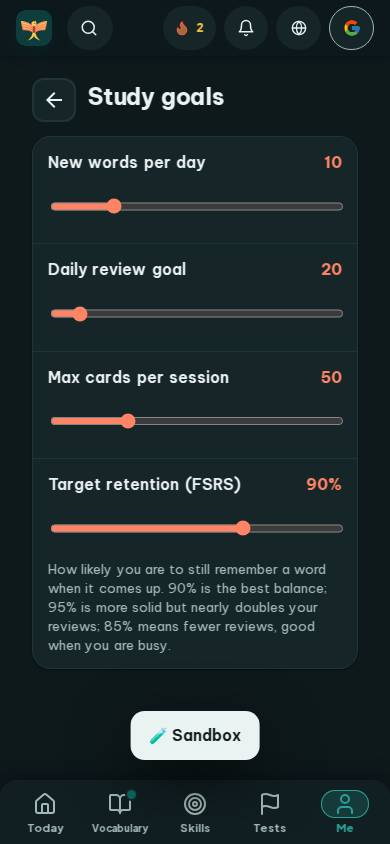
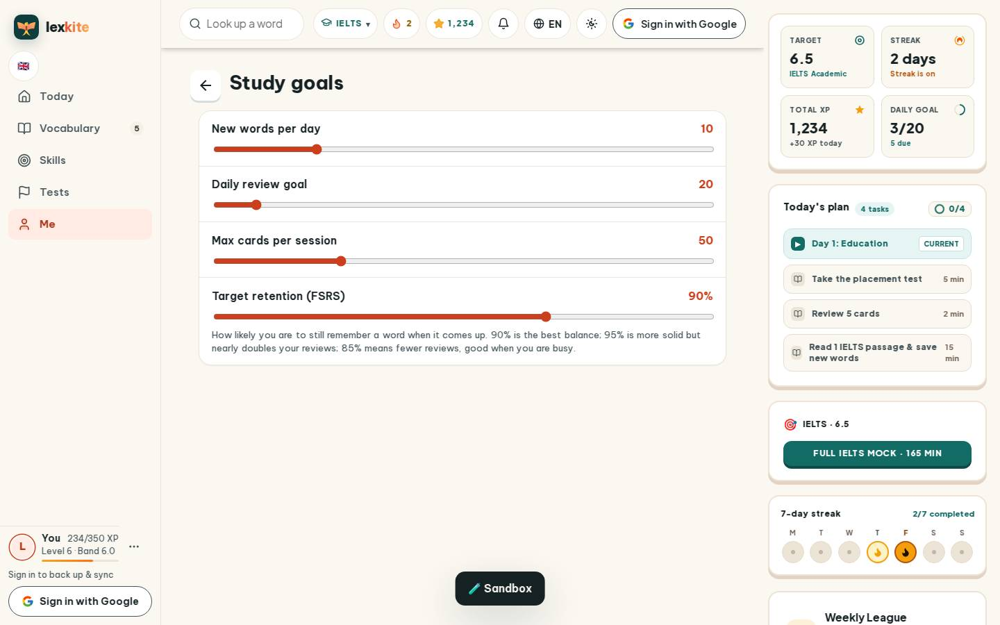
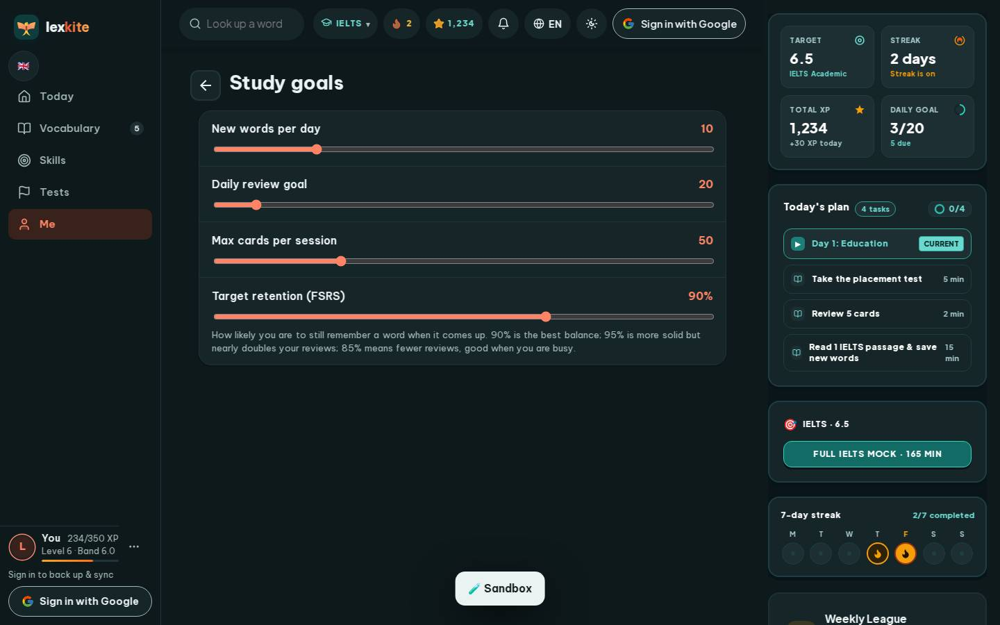

# #/settings/study

Điểm: **93** · độ phủ 100 % · /settings/study

- Chức năng: 100
- Lỗi JS: 100
- Rỗng/lỗi/tải: 100
- Back/Thoát: –
- Tương phản: 100
- Chạm ≥44: 100
- Bố cục: 100
- i18n 15: 100
- Hiệu năng: 57
- Độ đẹp: 79

## Lỗi
- [perf] LCP 5492 ms · CLS 0.0039 · TBT 98 ms
- [beauty] Generic web-style sliders lack Duolingo's playful, chunky control polish
- [beauty] Sandbox banner feels like a raw debug note, not integrated UI
- [beauty] Top nav icons are plain and inconsistent in weight/style

## Ảnh
390l 
390d 
1440l 
1440d 
