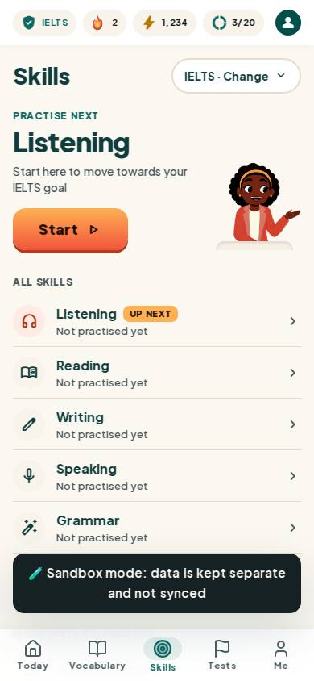
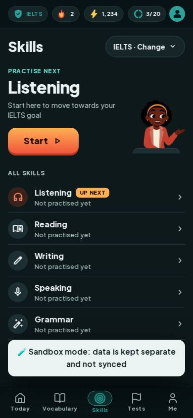
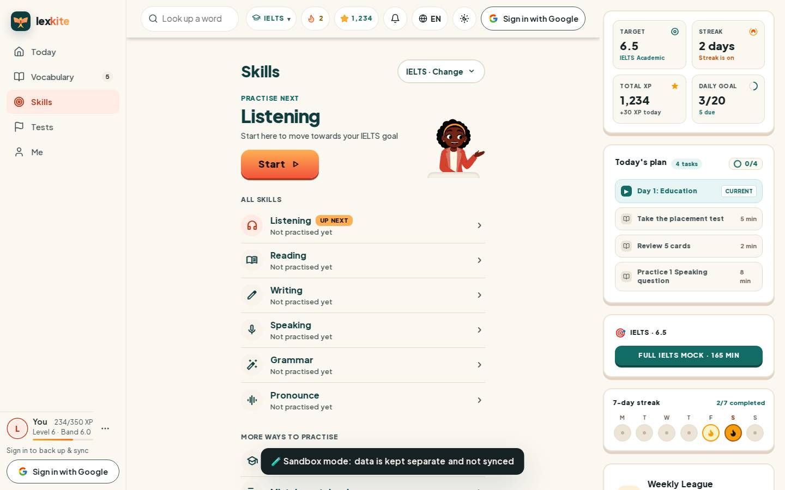
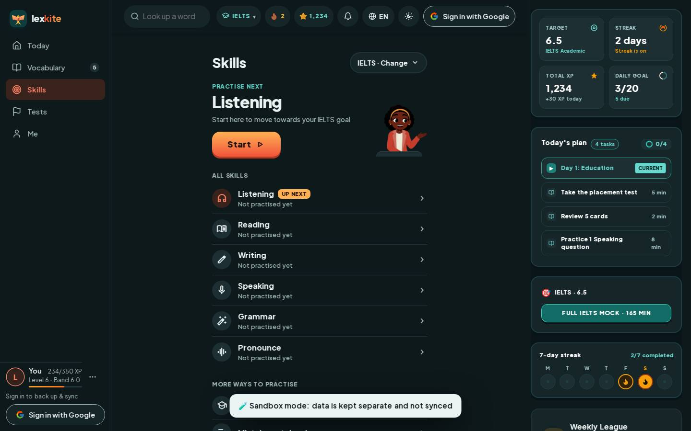

# #/skill

Điểm: **93** · độ phủ 100 % · /skill

- Chức năng: 100
- Lỗi JS: 100
- Rỗng/lỗi/tải: 100
- Back/Thoát: –
- Tương phản: 90
- Chạm ≥44: 100
- Bố cục: 85
- i18n 15: 100
- Hiệu năng: 74
- Độ đẹp: 87

## Lỗi
- [contrast] a[data-ext-cta="rail"]
- [layout] div.flex.flex-col>section.pt-5.pb-6>div.w-[116px].min-h-[132px] – nội dung tràn ngang 20px bị cắt: "div.w-[116px].min-h-[132px]>span.tslot.t
- [perf] LCP 4280 ms · CLS 0.0012 · TBT 206 ms
- [beauty] Sandbox mode banner is a raw, dark toast overlaying content
- [beauty] Character illustration feels slightly pasted on rather than integrated
- [beauty] Top status bar icons are small and low-contrast

## Ảnh
390l 
390d 
1440l 
1440d 
