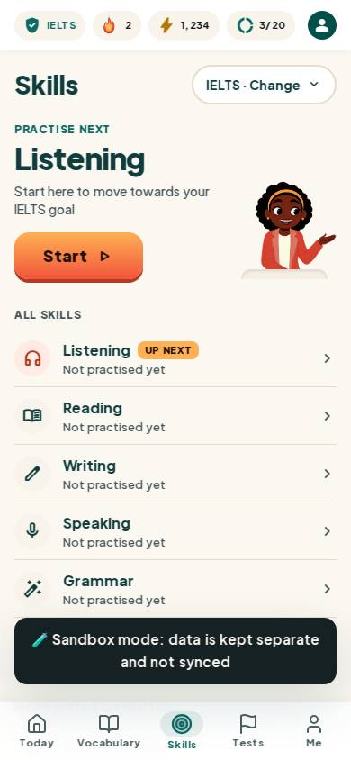
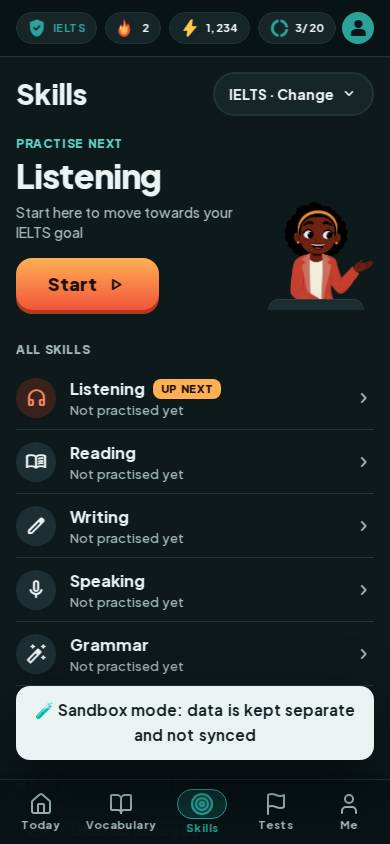
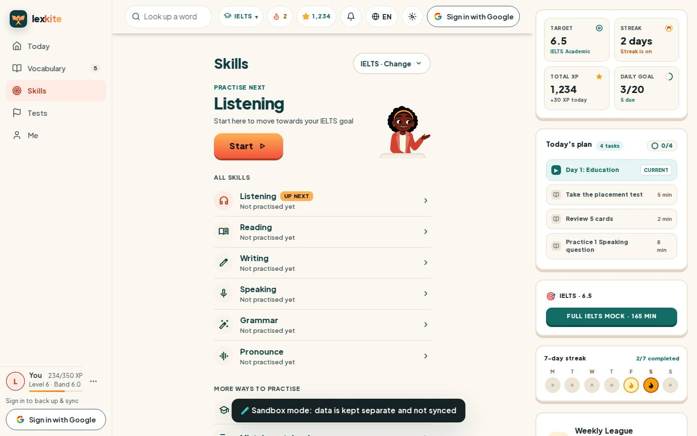
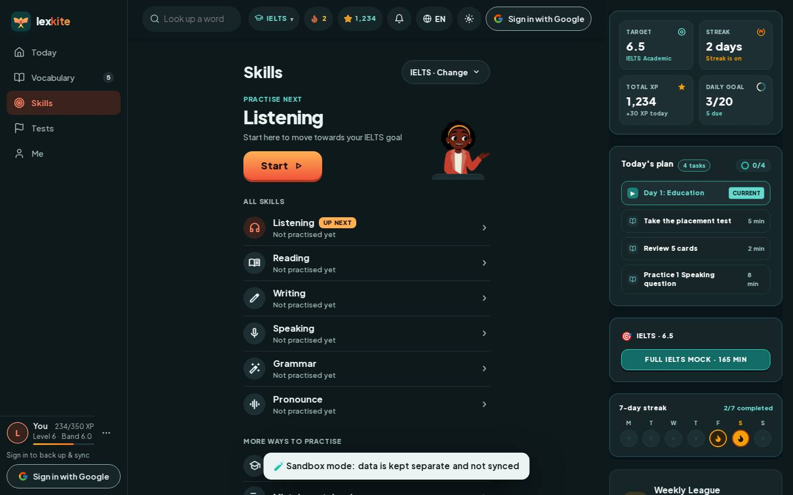

# #/skills

Điểm: **95** · độ phủ 100 % · /skills

- Chức năng: 100
- Lỗi JS: 100
- Rỗng/lỗi/tải: 100
- Back/Thoát: –
- Tương phản: 100
- Chạm ≥44: 100
- Bố cục: 85
- i18n 15: 100
- Hiệu năng: 82
- Độ đẹp: 86

## Lỗi
- [layout] div.flex.flex-col>section.pt-5.pb-6>div.w-[116px].min-h-[132px] – nội dung tràn ngang 20px bị cắt: "div.w-[116px].min-h-[132px]>span.tslot.t
- [perf] LCP 3792 ms · CLS 0.0001 · TBT 107 ms
- [beauty] Sandbox mode banner is a harsh, dark block that disrupts the light, friendly theme.
- [beauty] Top status bar icons (flame, lightning) feel slightly generic compared to Duolingo's polished assets.
- [beauty] Sandbox mode banner feels like a raw debug overlay

## Ảnh
390l 
390d 
1440l 
1440d 
