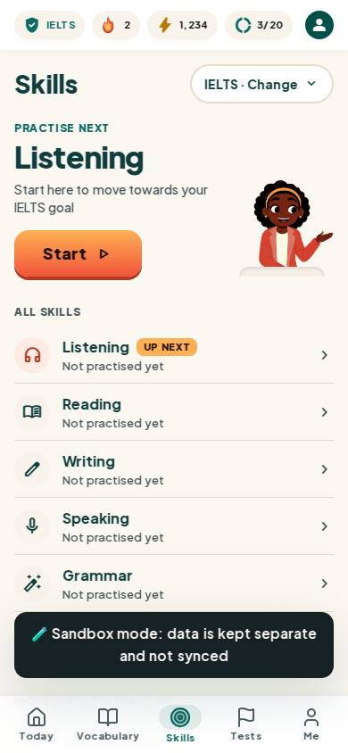
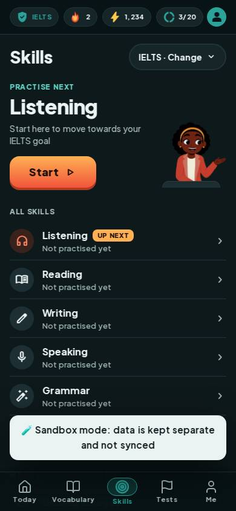
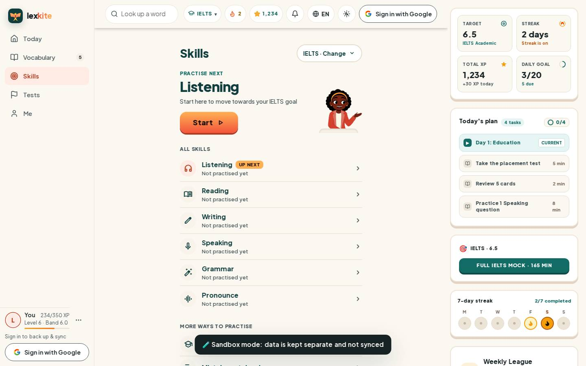
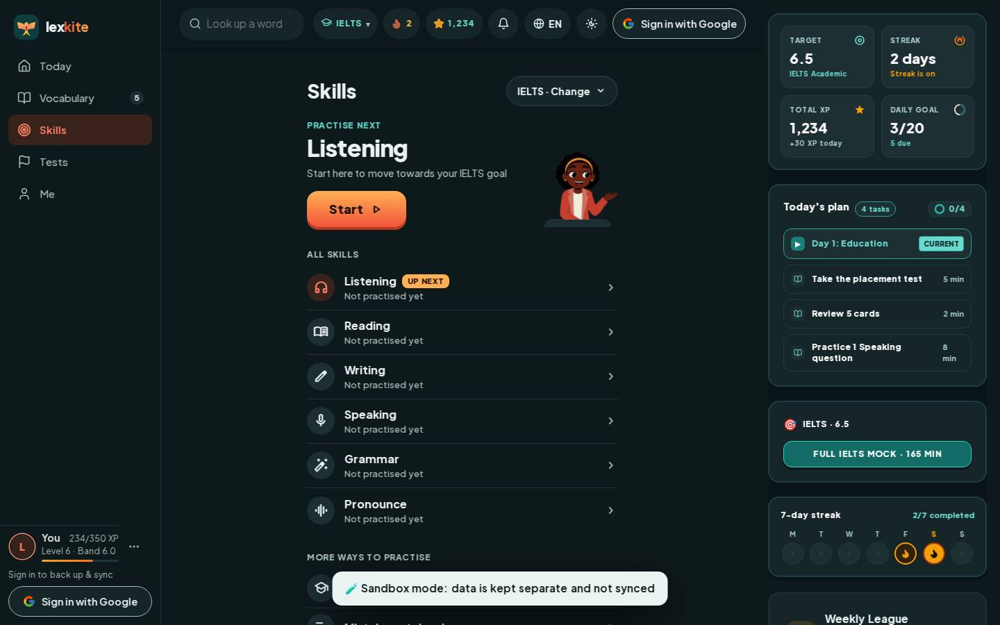

# #/speak

Điểm: **92** · độ phủ 100 % · /speak

- Chức năng: 100
- Lỗi JS: 100
- Rỗng/lỗi/tải: 100
- Back/Thoát: –
- Tương phản: 100
- Chạm ≥44: 100
- Bố cục: 85
- i18n 15: 100
- Hiệu năng: 50
- Độ đẹp: 86

## Lỗi
- [layout] div.flex.flex-col>section.pt-5.pb-6>div.w-[116px].min-h-[132px] – nội dung tràn ngang 20px bị cắt: "div.w-[116px].min-h-[132px]>span.tslot.t
- [perf] LCP 6028 ms · CLS 0.0022 · TBT 69 ms
- [beauty] Sandbox mode banner is a raw, dark toast that breaks the light theme
- [beauty] Character illustration feels slightly pasted rather than integrated into the layout
- [beauty] Top stat pills have uneven internal spacing and alignment

## Ảnh
390l 
390d 
1440l 
1440d 
