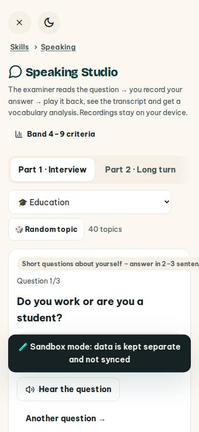
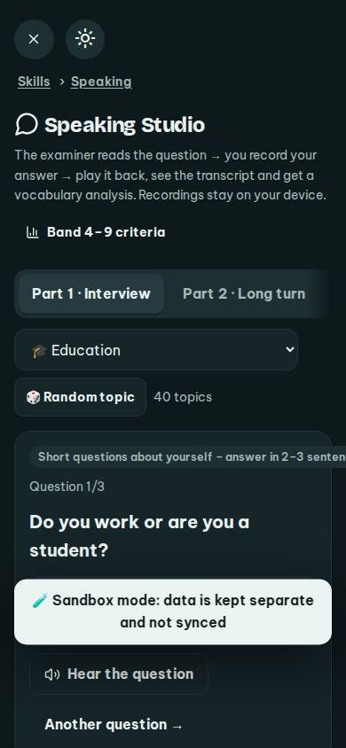
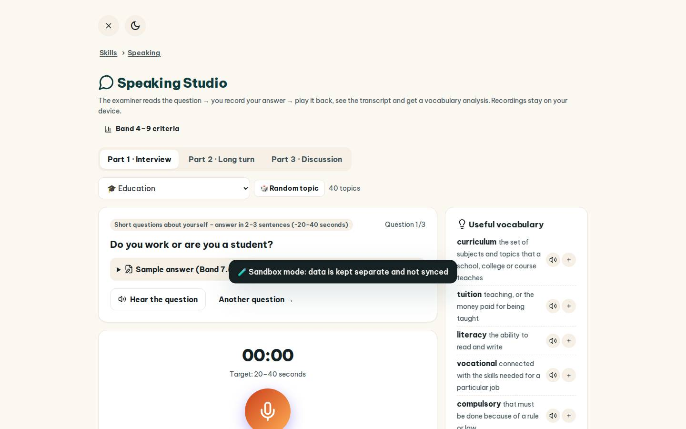
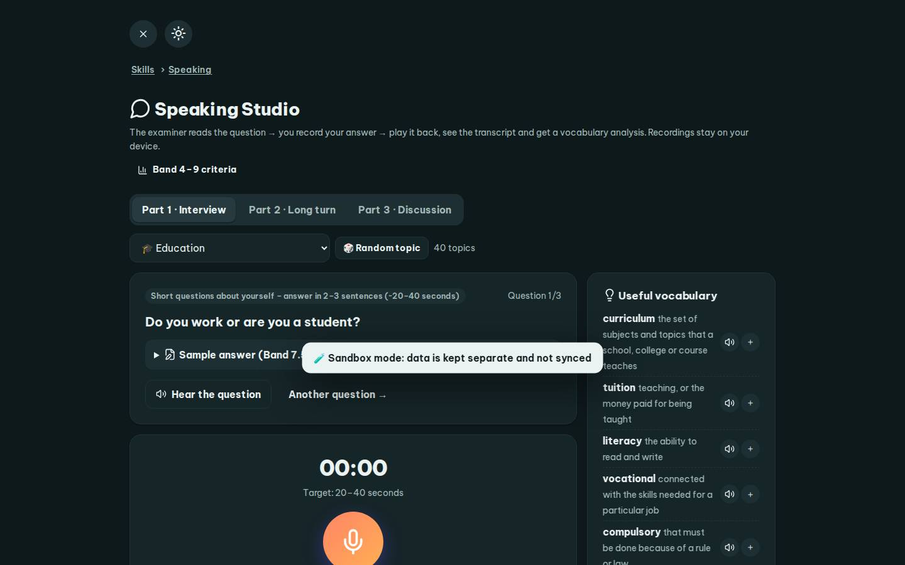

# #/speaking

Điểm: **86** · độ phủ 100 % · /speaking

- Chức năng: 100
- Lỗi JS: 100
- Rỗng/lỗi/tải: 100
- Back/Thoát: 100
- Tương phản: 100
- Chạm ≥44: 68
- Bố cục: 55
- i18n 15: 100
- Hiệu năng: 50
- Độ đẹp: 72

## Lỗi
- [tap] div.row.between>div>a.btn.sm – "Band 4–9 criteria" vùng chạm 184×36 < 44px
- [tap] main#view>div.tabs>button – "Part 1 · Interview" vùng chạm 164×41 < 44px
- [tap] button#spRand – "🎲 Random topic" vùng chạm 149×36 < 44px
- [tap] div#sampleBox>details.sample-box>summary – "Sample answer (Band 7.5–8) – view it aft" vùng chạm 634×25 < 44px
- [layout] div.shell>div.main – nội dung tràn ngang 153px bị cắt: "Part 3 · Discussion", "Short questions about yourself – answer "
- [layout] div.card>div.row.between>span.chip – "Short questions about yourself – answer " lòi ra ngoài div#spGrid>div.stack>div.card 169px
- [layout] select#spTopic – select "🎓 Education" không có nhãn nhìn thấy – người học không biết ô này để làm gì
- [perf] LCP 7280 ms · CLS 0 · TBT 61 ms
- [beauty] Text in the 'Short questions' banner is cut off on the right.
- [beauty] Dark 'Sandbox mode' toast overlaps content, creating visual clutter.
- [beauty] Generic UI elements lack the polished, playful character of Duolingo.

## Ảnh
390l 
390d 
1440l 
1440d 
