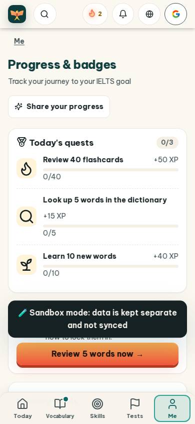
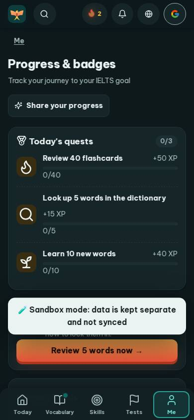
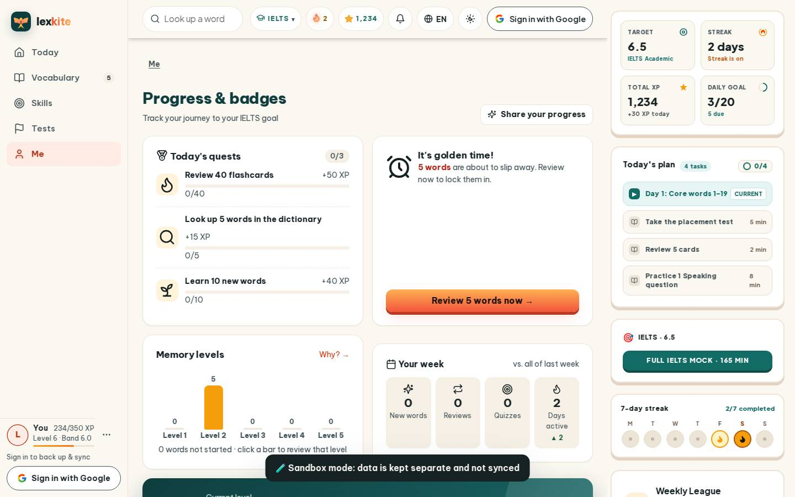
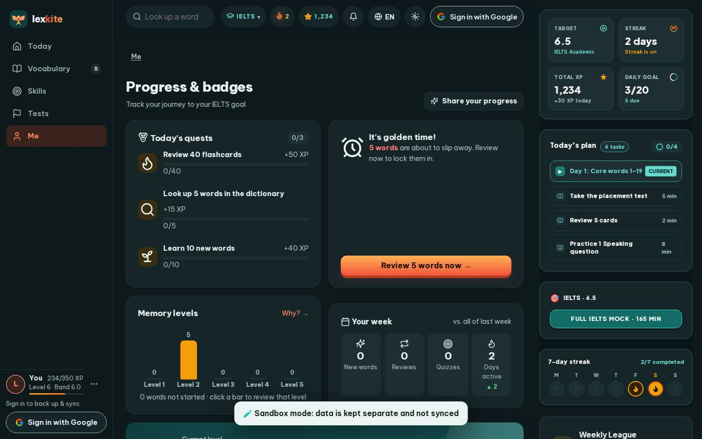

# #/stats

Điểm: **90** · độ phủ 100 % · /stats

- Chức năng: 100
- Lỗi JS: 100
- Rỗng/lỗi/tải: 100
- Back/Thoát: –
- Tương phản: 100
- Chạm ≥44: 68
- Bố cục: 55
- i18n 15: 100
- Hiệu năng: 79
- Độ đẹp: 83

## Lỗi
- [tap] main#view>div.page-head>button.btn.sm – "Share your progress" vùng chạm 204×36 < 44px
- [tap] div#goldenCard>a.btn.primary – "Review 5 words now →" vùng chạm 350×41 < 44px
- [tap] div.card>div.row.between>a.small – "Why? →" vùng chạm 55×22 < 44px
- [tap] div>div.big-num>button.streak-freeze-badge – "🧊×0" vùng chạm 50×28 < 44px
- [layout] main#view>div.card.hero-main – nội dung tràn ngang 60px bị cắt
- [layout] main#view>div.card>div.heat – nội dung tràn ngang 78px bị cắt: "2026-10-05: Not started", "2026-10-06: Not started", "2026-10-07: Not starte
- [layout] span#xpPill – nội dung tràn ngang 103px bị cắt
- [perf] LCP 3988 ms · CLS 0.0032 · TBT 68 ms
- [beauty] Sandbox banner overlaps and obscures the 'How to look them in' text.
- [beauty] Top navigation bar icons are unevenly spaced and misaligned.
- [beauty] Primary action button is partially hidden behind the dark banner.

## Ảnh
390l 
390d 
1440l 
1440d 
