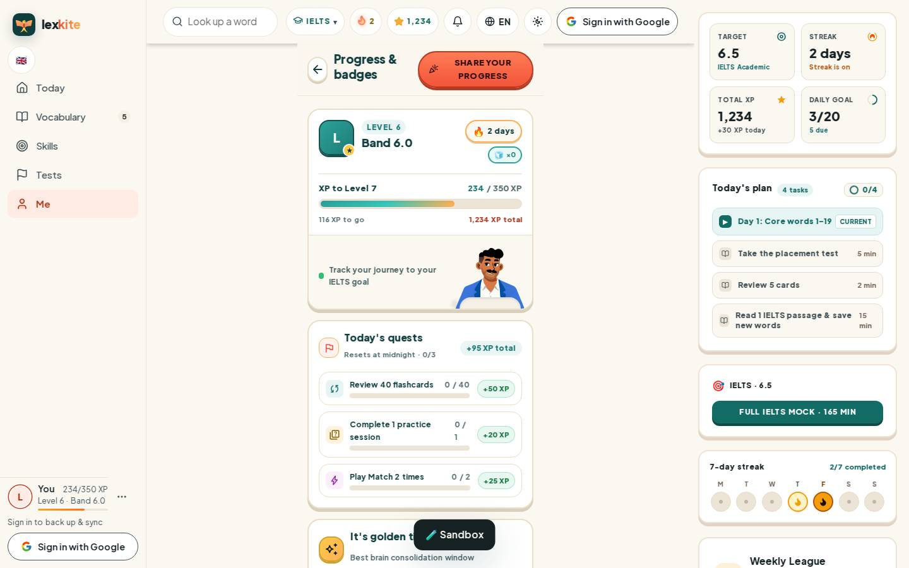
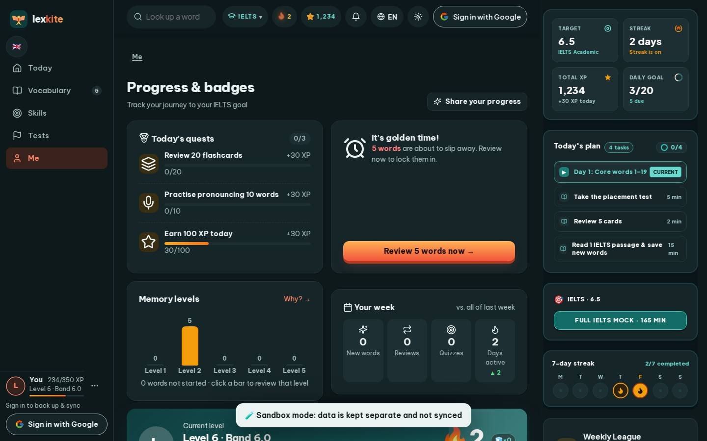

# #/stats

Điểm: **87** · độ phủ 86 % · /stats

- Chức năng: 100
- Lỗi JS: 100
- Rỗng/lỗi/tải: 100
- Back/Thoát: –
- Tương phản: 100
- Chạm ≥44: 100
- Bố cục: 40
- i18n 15: 100
- Hiệu năng: 47
- Độ đẹp: ∅

## Lỗi
- [layout] main.flex-1.px-4>div.relative.pt-2>div.p-4.relative – nội dung tràn ngang 12px bị cắt: "div.relative.w-28>span.tslot.tslot-m>span.tslot-fig"
- [layout] header.sticky.top-0>div.flex.items-center>button.w-10.h-10 – "arrow_back" bị div.flex.items-center>a.flex.items-center>div.h-8.px-2.5 đè lên
- [layout] div.w-full.max-w-[390px]>header.sticky.top-0>button.[background:linear-gradient(180deg,_#FF7B54_0%,_#F2553B_100%)].[border:2px_solid_#B53A22
- [layout] span#xpPill – nội dung tràn ngang 75px bị cắt
- [perf] LCP 8052 ms · CLS 0.0001 · TBT 311 ms

## Ảnh
390l 
390d 
1440l 
1440d 
