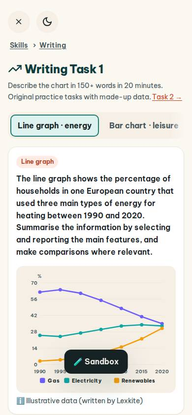
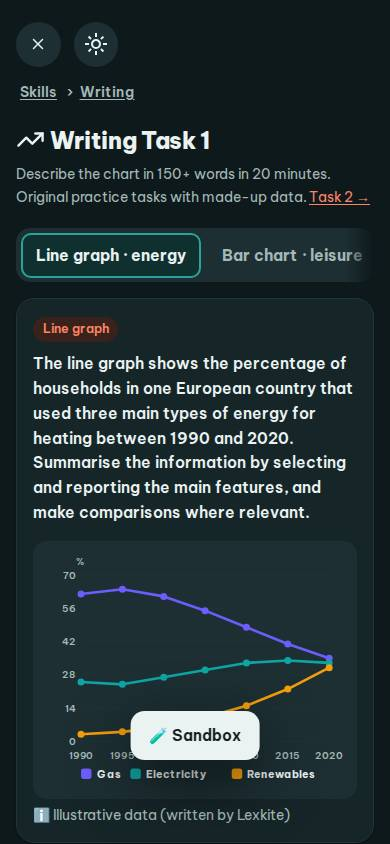
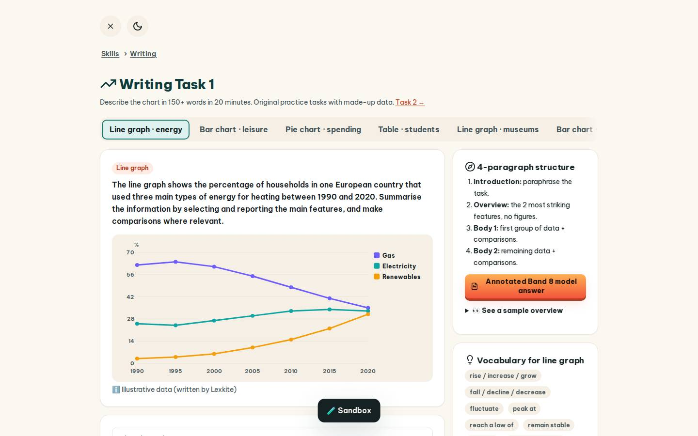
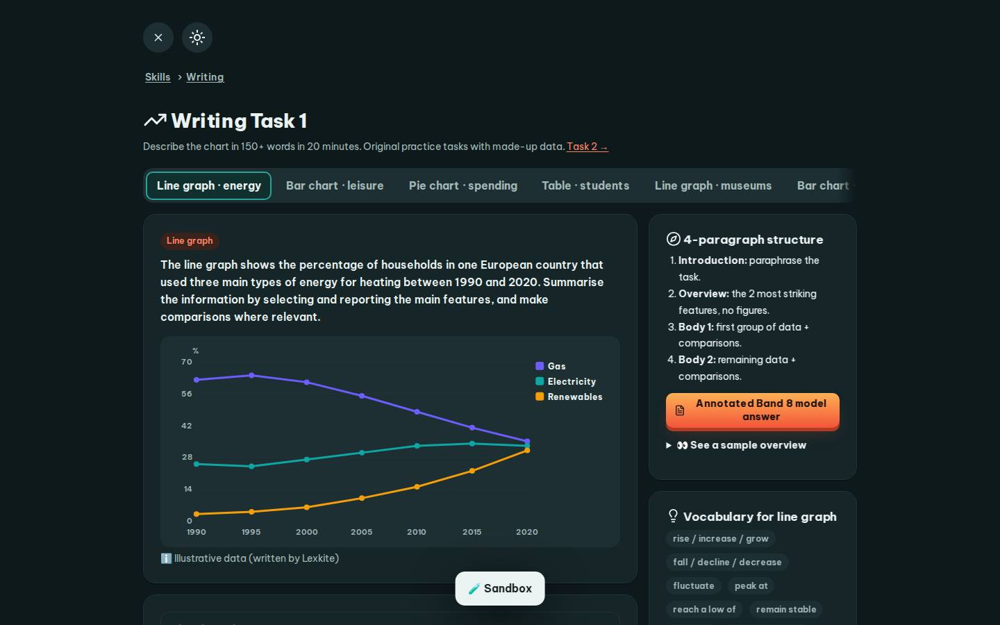

# #/task1

Điểm: **85** · độ phủ 86 % · /task1

- Chức năng: 100
- Lỗi JS: 100
- Rỗng/lỗi/tải: 100
- Back/Thoát: 100
- Tương phản: 100
- Chạm ≥44: 68
- Bố cục: 100
- i18n 15: 27
- Hiệu năng: 50
- Độ đẹp: ∅

## Lỗi
- [tap] main#view>div.tabs.fade-end>button – "Line graph · energy" vùng chạm 180×41 < 44px
- [tap] button#tBtn – "Start timer" vùng chạm 133×36 < 44px
- [tap] div.row.between>div.row>button.btn.sm – "Rewrite selected sentence" vùng chạm 247×36 < 44px
- [tap] div.card>div.row>button.chip – "rise / increase / grow" vùng chạm 157×24 < 44px
- [i18n] ar: thiếu dịch «Writing Task 1»
- [i18n] es: thiếu dịch «Writing Task 1»
- [i18n] hi: thiếu dịch «Writing Task 1»
- [i18n] id: thiếu dịch «Writing Task 1»
- [perf] LCP 8216 ms · CLS 0 · TBT 74 ms

## Ảnh
390l 
390d 
1440l 
1440d 
