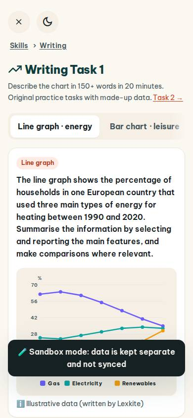
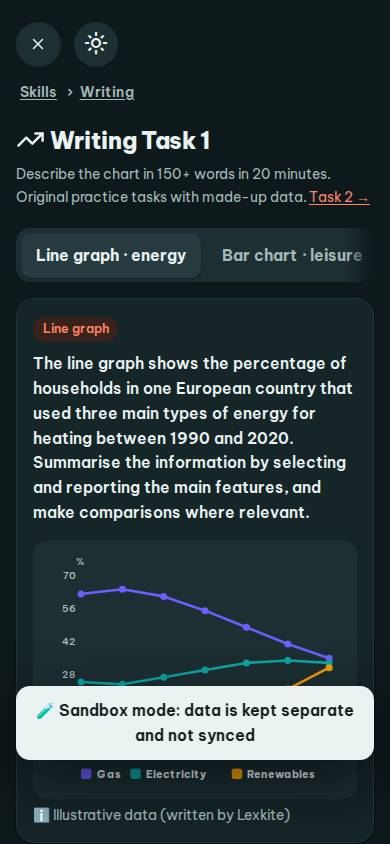
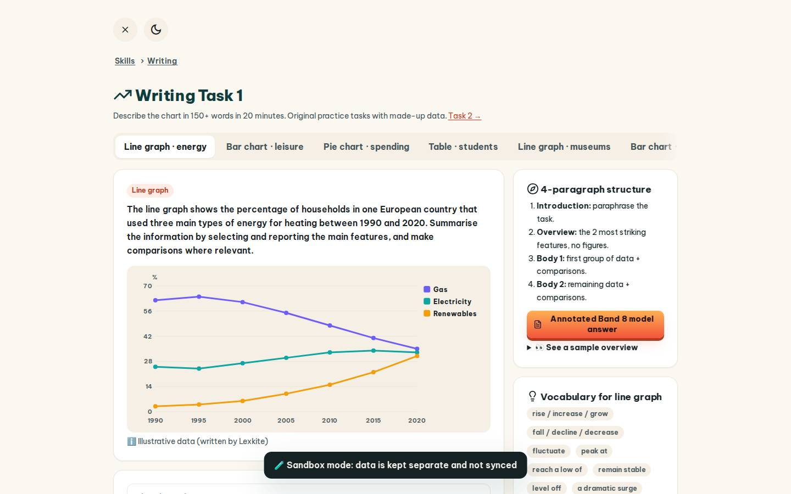
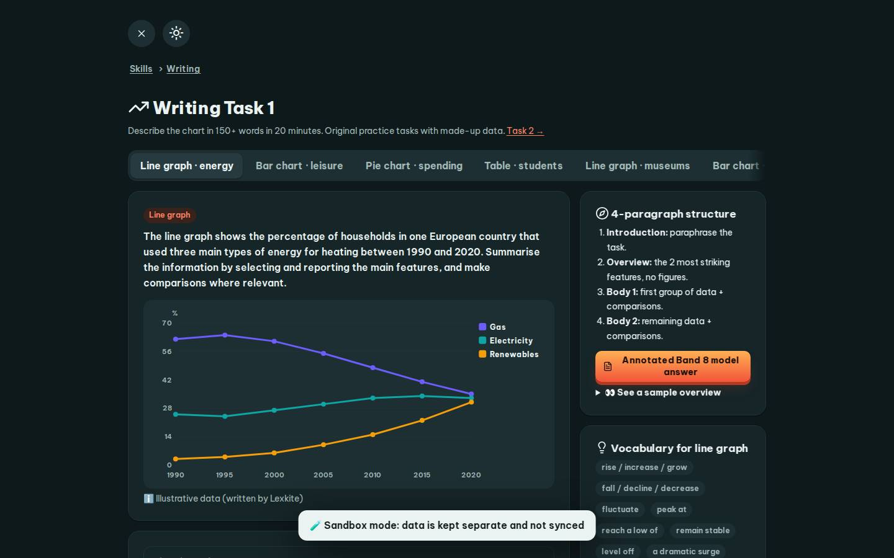

# #/task1

Điểm: **83** · độ phủ 100 % · /task1

- Chức năng: 100
- Lỗi JS: 100
- Rỗng/lỗi/tải: 100
- Back/Thoát: 100
- Tương phản: 100
- Chạm ≥44: 60
- Bố cục: 100
- i18n 15: 13
- Hiệu năng: 50
- Độ đẹp: 79

## Lỗi
- [tap] main#view>div.tabs.fade-end>button – "Line graph · energy" vùng chạm 180×41 < 44px
- [tap] button#tBtn – "Start timer" vùng chạm 133×36 < 44px
- [tap] div.row.between>div.row>button.btn.sm – "Rewrite selected sentence" vùng chạm 247×36 < 44px
- [tap] div.card>details>summary.small – "👀 See a sample overview" vùng chạm 250×22 < 44px
- [tap] div.card>div.row>button.chip – "rise / increase / grow" vùng chạm 157×24 < 44px
- [i18n] ar: thiếu dịch «Writing Task 1»
- [i18n] de: thiếu dịch «Writing Task 1»
- [i18n] es: thiếu dịch «Writing Task 1»
- [i18n] fr: thiếu dịch «Writing Task 1»
- [perf] LCP 7488 ms · CLS 0 · TBT 89 ms
- [beauty] Dark toast overlay obscures chart legend and data
- [beauty] No clear primary CTA button visible
- [beauty] Generic sans-serif typography lacks brand character

## Ảnh
390l 
390d 
1440l 
1440d 
