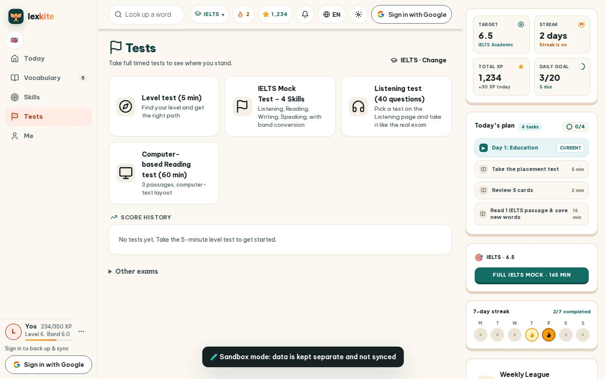
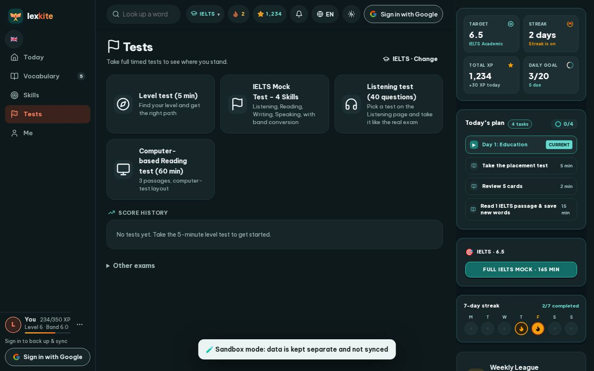

# #/tests

Điểm: **96** · độ phủ 100 % · /tests

- Chức năng: 100
- Lỗi JS: 100
- Rỗng/lỗi/tải: 100
- Back/Thoát: –
- Tương phản: 100
- Chạm ≥44: 92
- Bố cục: 100
- i18n 15: 100
- Hiệu năng: 86
- Độ đẹp: 82

## Lỗi
- [tap] main#view>div.page-head>button.btn.sm – "IELTS · Change" vùng chạm 159×36 < 44px
- [perf] LCP 3476 ms · CLS 0.0039 · TBT 31 ms
- [beauty] Dark toast notification obscures content and breaks visual flow
- [beauty] Generic card design lacks Duolingo's playful character integration
- [beauty] Inconsistent icon styles across navigation and list items

## Ảnh
390l 
390d 
1440l 
1440d 
