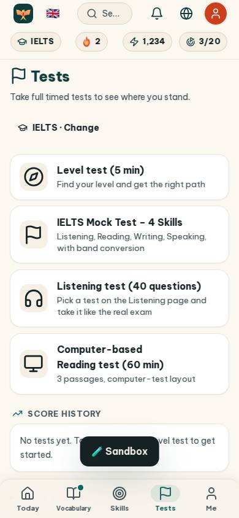
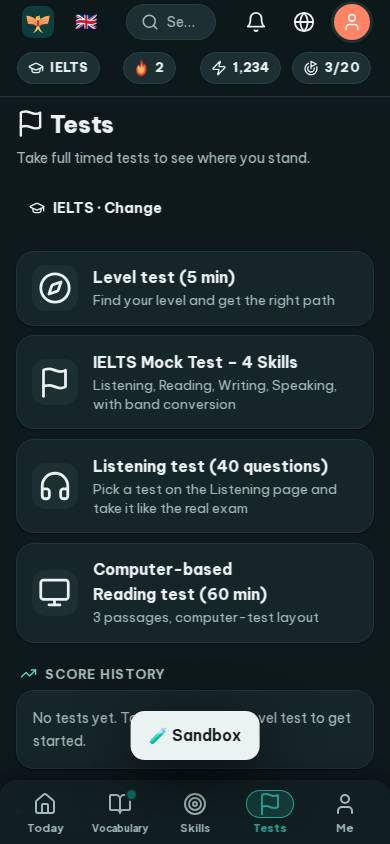

# #/tests

Điểm: **95** · độ phủ 86 % · /tests

- Chức năng: 100
- Lỗi JS: 100
- Rỗng/lỗi/tải: 100
- Back/Thoát: –
- Tương phản: 100
- Chạm ≥44: 92
- Bố cục: 96
- i18n 15: 100
- Hiệu năng: 67
- Độ đẹp: ∅

## Lỗi
- [tap] main#view>div.page-head>button.btn.sm – "IELTS · Change" vùng chạm 159×36 < 44px
- [layout] button.hb-s>span>em – chữ bị cắt "…" (102>34px)
- [perf] LCP 4796 ms · CLS 0.0014 · TBT 15 ms

## Ảnh
390l 
390d 
1440l 
1440d 
