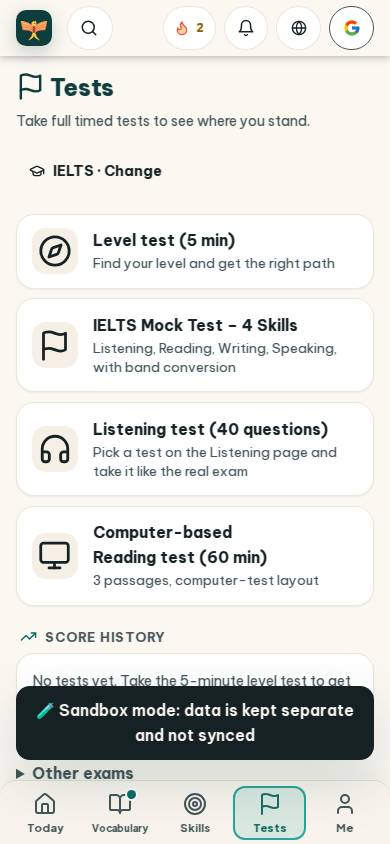
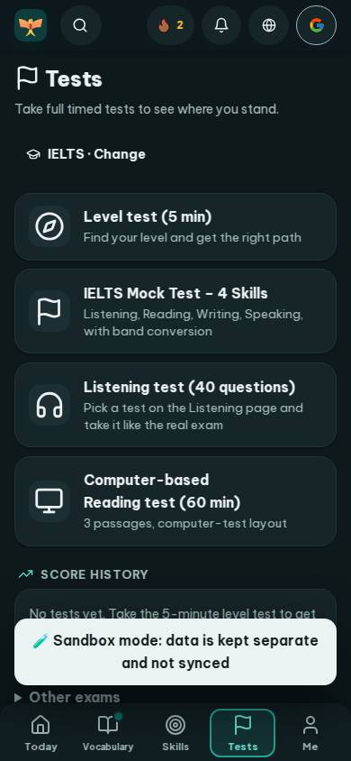
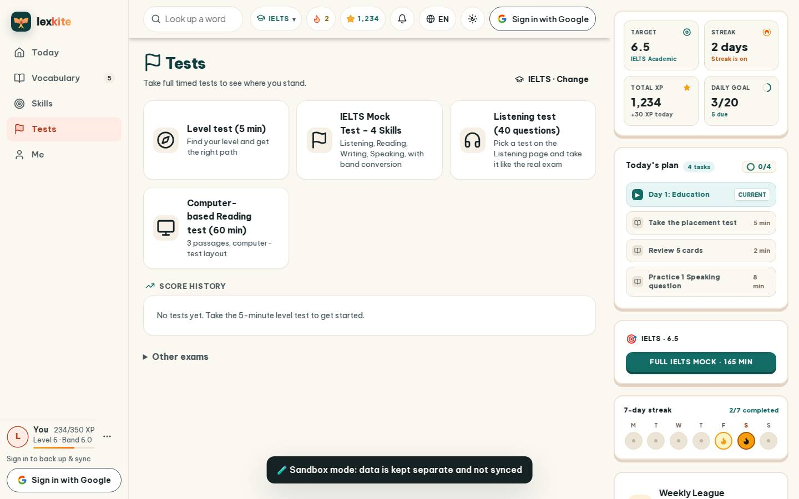
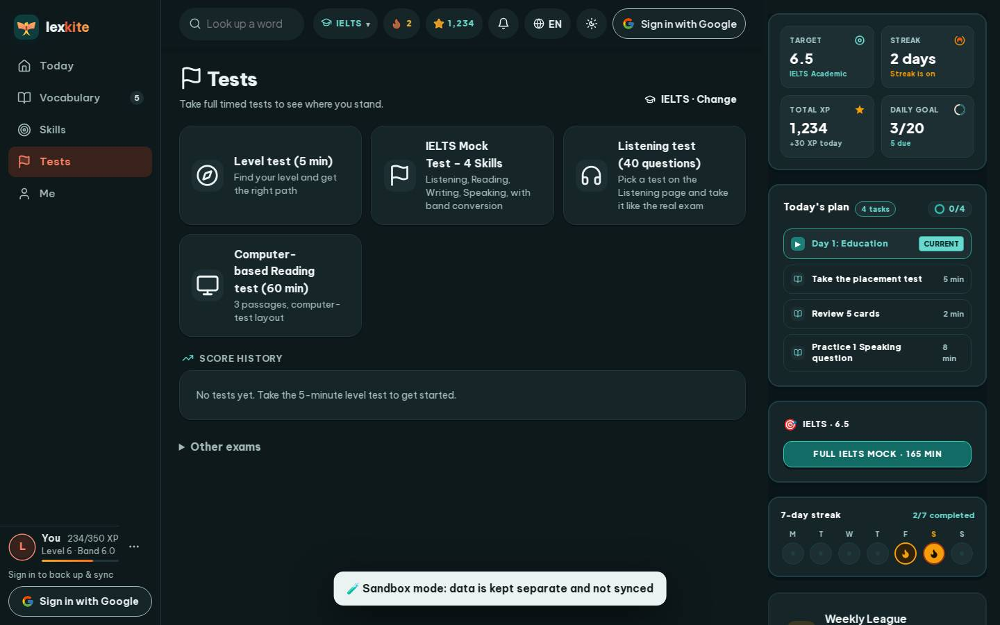

# #/tests

Điểm: **94** · độ phủ 100 % · /tests

- Chức năng: 100
- Lỗi JS: 100
- Rỗng/lỗi/tải: 100
- Back/Thoát: –
- Tương phản: 100
- Chạm ≥44: 84
- Bố cục: 100
- i18n 15: 100
- Hiệu năng: 78
- Độ đẹp: 81

## Lỗi
- [tap] main#view>div.page-head>button.btn.sm – "IELTS · Change" vùng chạm 159×36 < 44px
- [tap] main#view>details.hub-more>summary – "Other exams" vùng chạm 817×38 < 44px
- [perf] LCP 4028 ms · CLS 0.0031 · TBT 25 ms
- [beauty] Dark toast notification obscures content and feels intrusive
- [beauty] Generic, flat icons lack Duolingo's playful character integration
- [beauty] Top nav bar feels crowded with too many circular buttons

## Ảnh
390l 
390d 
1440l 
1440d 
