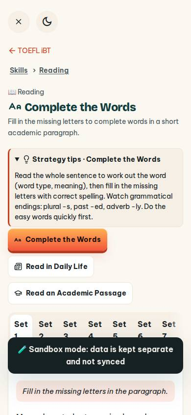
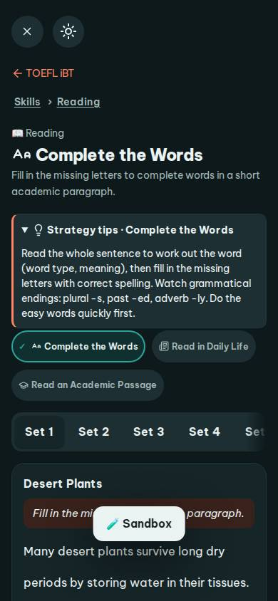
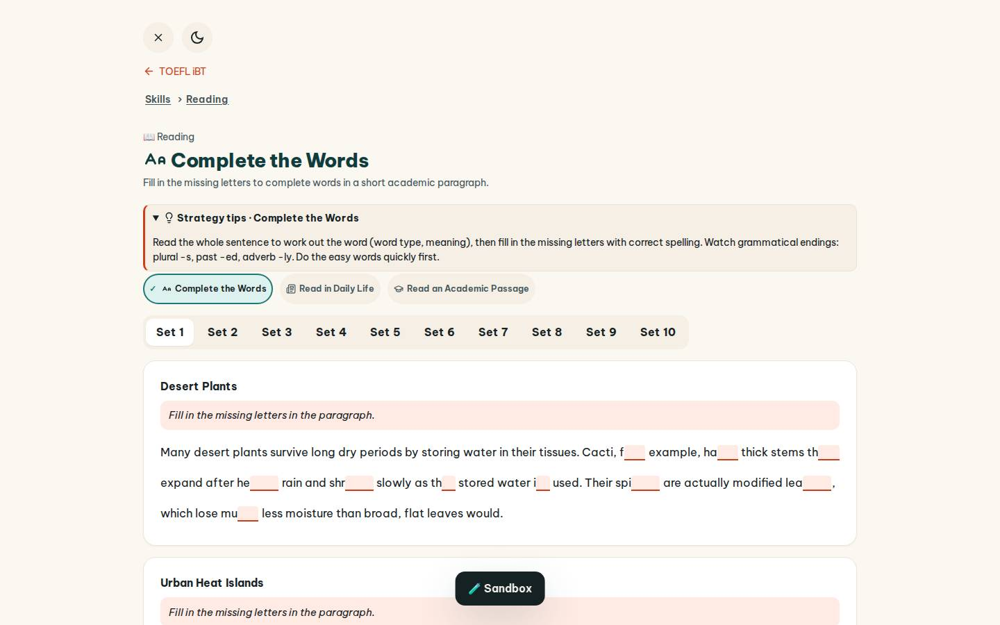
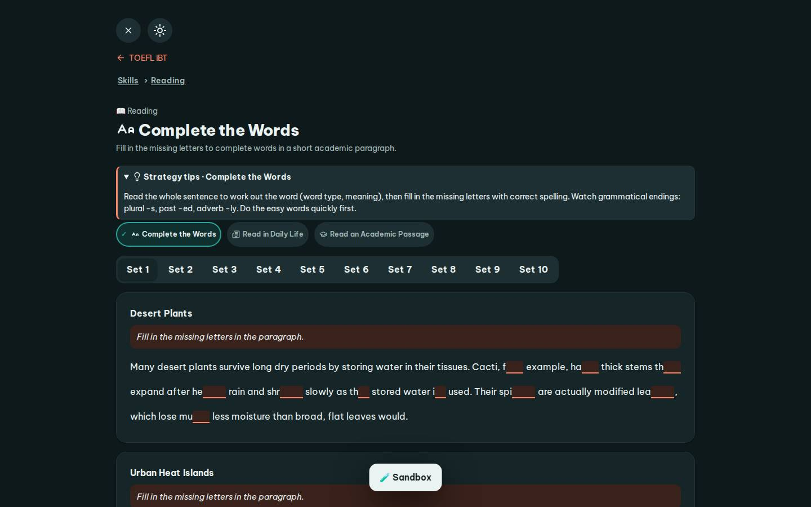

# #/toefl-p

Điểm: **94** · độ phủ 86 % · /toefl-p

- Chức năng: 100
- Lỗi JS: 100
- Rỗng/lỗi/tải: 100
- Back/Thoát: 100
- Tương phản: 100
- Chạm ≥44: 84
- Bố cục: 100
- i18n 15: 100
- Hiệu năng: 50
- Độ đẹp: ∅

## Lỗi
- [tap] div.cw-text>label.cw-slot>input.gap.cw – "Blank 1" vùng chạm 30×22 < 44px
- [tap] main#view>div.tabs>a – "Set 1" vùng chạm 69×39 < 44px
- [perf] LCP 11816 ms · CLS 0 · TBT 74 ms

## Ảnh
390l 
390d 
1440l 
1440d 
