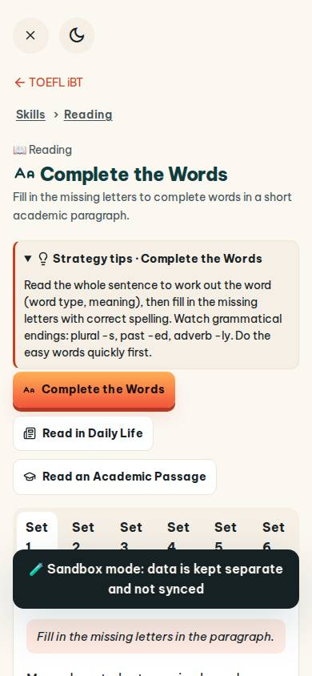
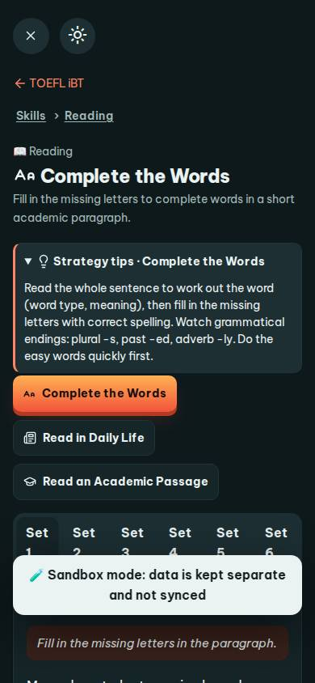
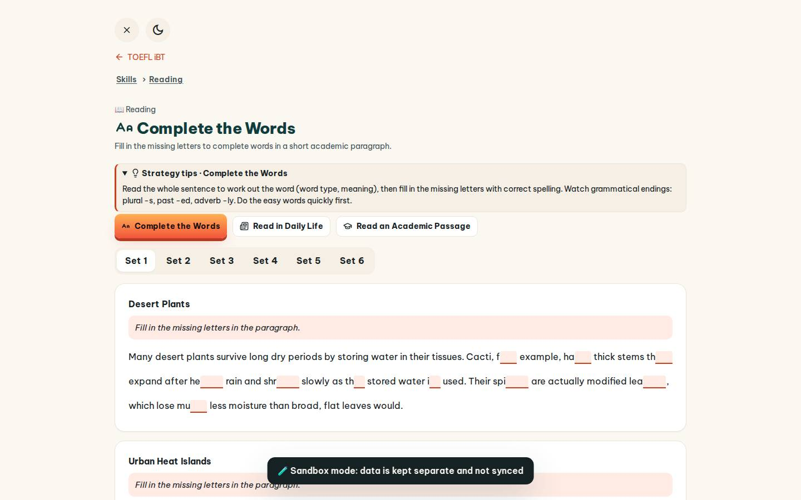
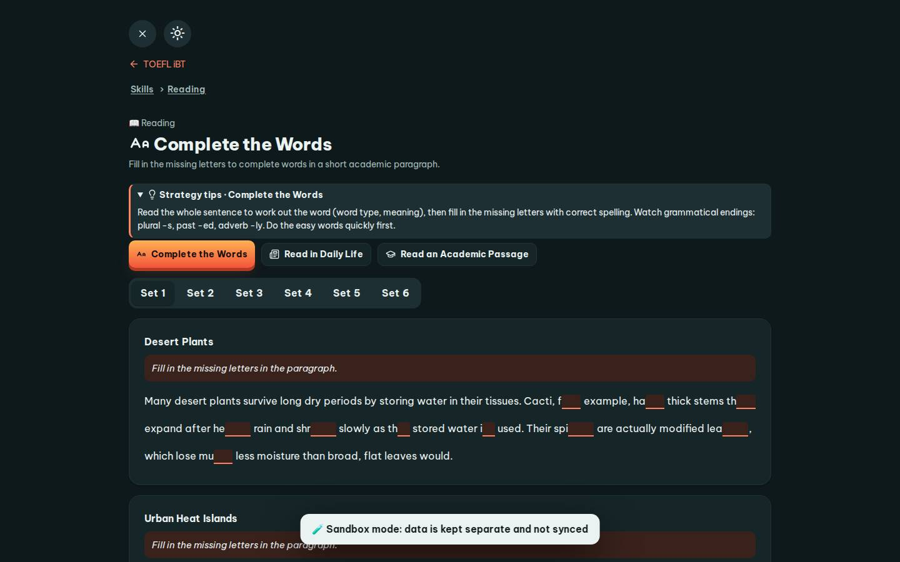

# #/toefl-p

Điểm: **90** · độ phủ 100 % · /toefl-p

- Chức năng: 100
- Lỗi JS: 100
- Rỗng/lỗi/tải: 100
- Back/Thoát: 100
- Tương phản: 100
- Chạm ≥44: 60
- Bố cục: 100
- i18n 15: 100
- Hiệu năng: 50
- Độ đẹp: 72

## Lỗi
- [tap] div.cw-text>label.cw-slot>input.gap.cw – "Blank 1" vùng chạm 30×22 < 44px
- [tap] main#view>a.small – "TOEFL iBT" vùng chạm 92×18 < 44px
- [tap] main#view>details.qtip>summary – "Strategy tips · Complete the Words" vùng chạm 1025×35 < 44px
- [tap] main#view>div.row>a.btn.sm – "Read in Daily Life" vùng chạm 176×36 < 44px
- [tap] main#view>div.tabs>a – "Set 1" vùng chạm 69×39 < 44px
- [perf] LCP 9748 ms · CLS 0 · TBT 83 ms
- [beauty] Dark toast banner obscures content and breaks layout flow
- [beauty] Generic web-style typography lacks Duolingo's playful character
- [beauty] Raw 'Set 1-6' tabs look unfinished and cluttered

## Ảnh
390l 
390d 
1440l 
1440d 
