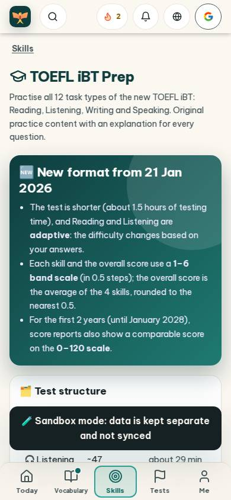
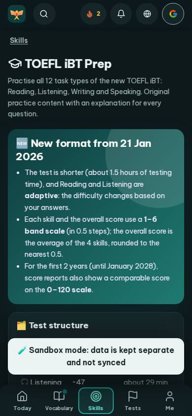
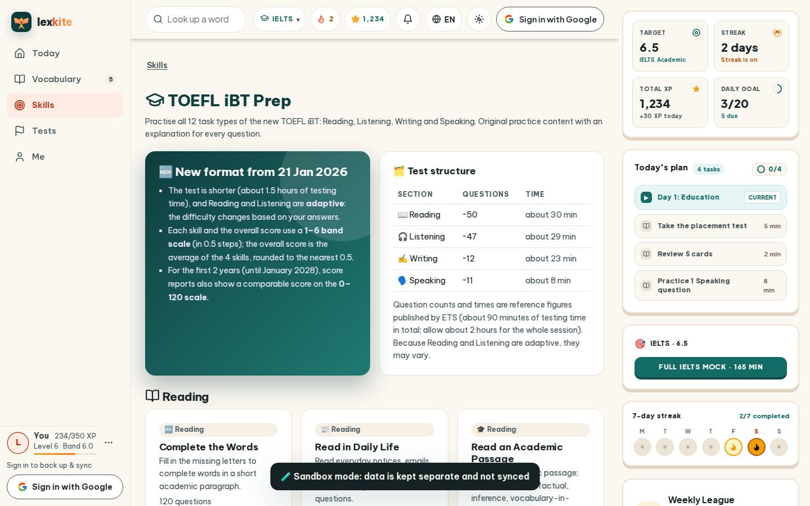
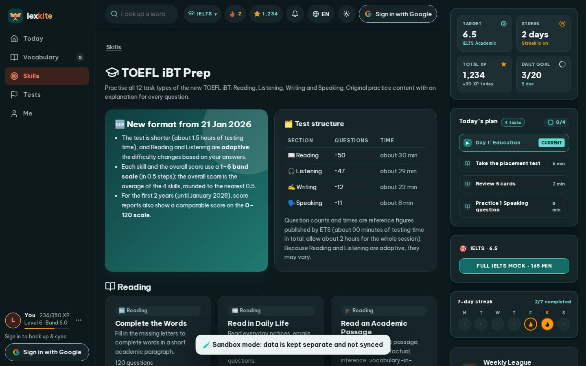

# #/toefl

Điểm: **82** · độ phủ 100 % · /toefl

- Chức năng: 100
- Lỗi JS: 100
- Rỗng/lỗi/tải: 100
- Back/Thoát: –
- Tương phản: 100
- Chạm ≥44: 100
- Bố cục: 85
- i18n 15: 13
- Hiệu năng: 50
- Độ đẹp: 74

## Lỗi
- [layout] main#view>div.grid.g2>div.card.hero-main – nội dung tràn ngang 60px bị cắt
- [i18n] ar: thiếu dịch «Reading» · thiếu dịch «Listening»
- [i18n] de: thiếu dịch «Reading» · thiếu dịch «Listening»
- [i18n] es: thiếu dịch «Reading» · thiếu dịch «Listening»
- [i18n] fr: thiếu dịch «Reading» · thiếu dịch «Listening»
- [perf] LCP 9384 ms · CLS 0.0031 · TBT 52 ms
- [beauty] Generic system font lacks Duolingo's playful character
- [beauty] Dense text block feels cluttered, not scannable
- [beauty] Flat icons lack the polished 3D feel of the anchor

## Ảnh
390l 
390d 
1440l 
1440d 
