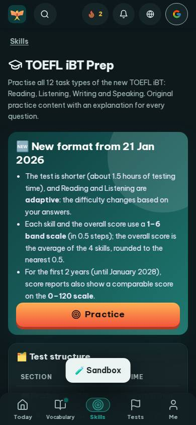
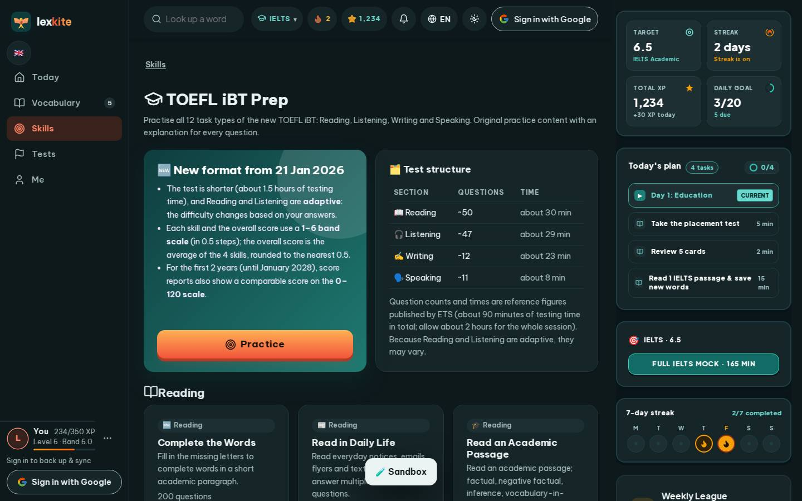

# #/toefl

Điểm: **90** · độ phủ 100 % · /toefl

- Chức năng: 100
- Lỗi JS: 100
- Rỗng/lỗi/tải: 100
- Back/Thoát: –
- Tương phản: 100
- Chạm ≥44: 100
- Bố cục: 85
- i18n 15: 100
- Hiệu năng: 50
- Độ đẹp: 72

## Lỗi
- [layout] main#view>div.grid.g2>div.card.hero-main – nội dung tràn ngang 60px bị cắt
- [perf] LCP 11236 ms · CLS 0.0039 · TBT 92 ms
- [beauty] Generic sans-serif typography lacks Duolingo's playful character
- [beauty] Dense text blocks feel utilitarian, not engaging
- [beauty] Flat icons and muted colors feel generic

## Ảnh
390l 
390d 
1440l 
1440d 
