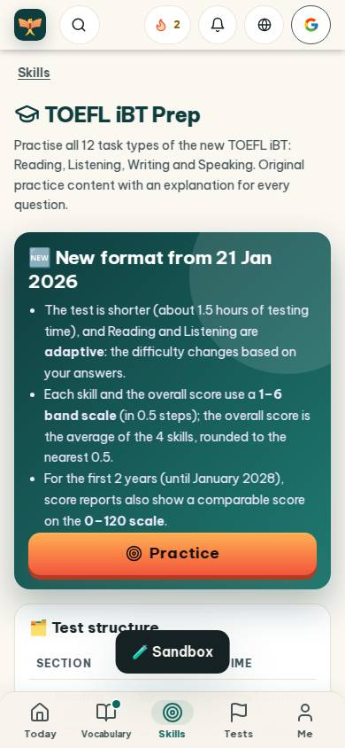
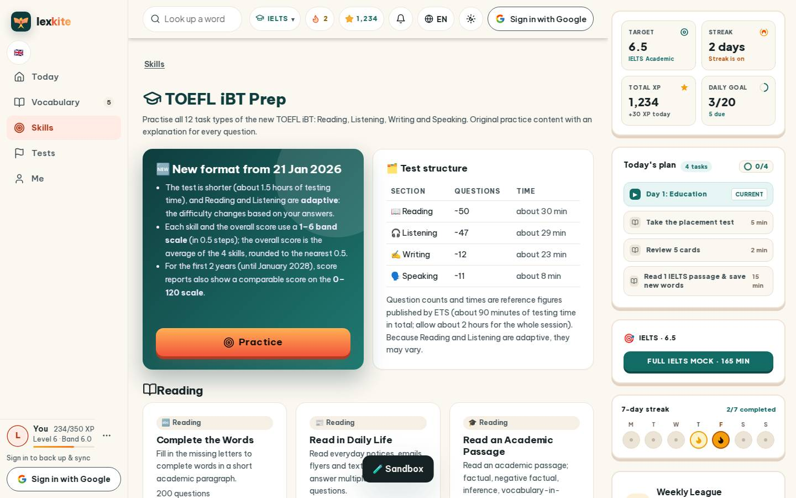

# #/toefl

Điểm: **92** · độ phủ 86 % · /toefl

- Chức năng: 100
- Lỗi JS: 100
- Rỗng/lỗi/tải: 100
- Back/Thoát: –
- Tương phản: 100
- Chạm ≥44: 92
- Bố cục: 85
- i18n 15: 93
- Hiệu năng: 50
- Độ đẹp: ∅

## Lỗi
- [tap] div.card>div.row>a.btn.sm – "Practice" vùng chạm 115×36 < 44px
- [layout] main#view>div.grid.g2>div.card.hero-main – nội dung tràn ngang 60px bị cắt
- [i18n] ar: thiếu dịch «Reading» · thiếu dịch «Listening»
- [perf] LCP 10608 ms · CLS 0.0033 · TBT 93 ms

## Ảnh
390l 
390d 
1440l 
1440d 
