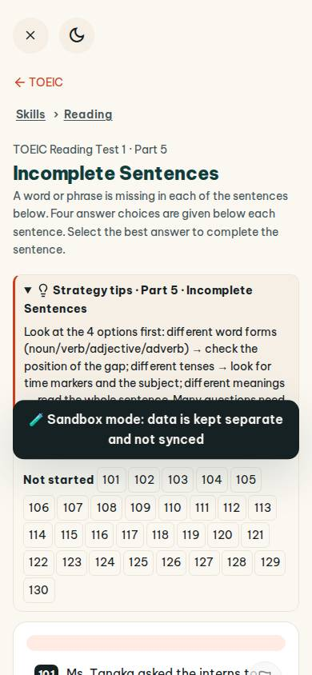
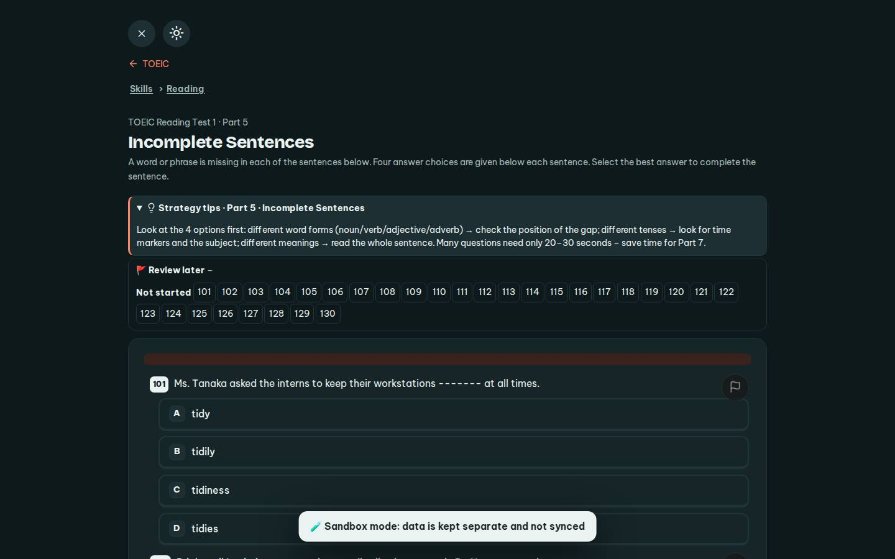

# #/toeic-r

Điểm: **82** · độ phủ 86 % · /toeic-r

- Chức năng: 100
- Lỗi JS: 100
- Rỗng/lỗi/tải: 100
- Back/Thoát: 100
- Tương phản: 100
- Chạm ≥44: 100
- Bố cục: 70
- i18n 15: 13
- Hiệu năng: 50
- Độ đẹp: ∅

## Lỗi
- [layout] button#tSub – "Submit & see explanations" bị div#tq>div.qe-rv>span.qe-rv-g đè lên
- [layout] div.qe-rv>span.qe-rv-g>button.qe-n – "130" rớt xuống đứng một mình ở dòng cuối của div#tq>div.qe-rv>span.qe-rv-g
- [i18n] ar: thiếu dịch «to»
- [i18n] de: thiếu dịch «to»
- [i18n] es: thiếu dịch «to»
- [i18n] fr: thiếu dịch «to»
- [perf] LCP 10092 ms · CLS 0 · TBT 105 ms

## Ảnh
390l 
390d 
1440l 
1440d 
