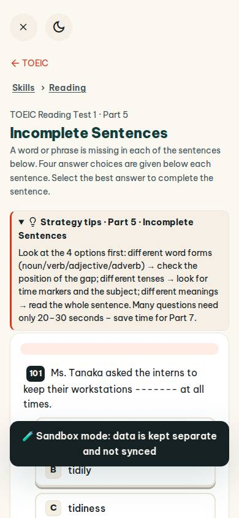
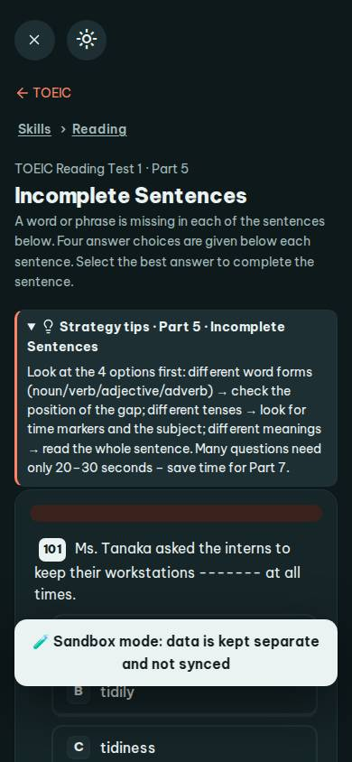
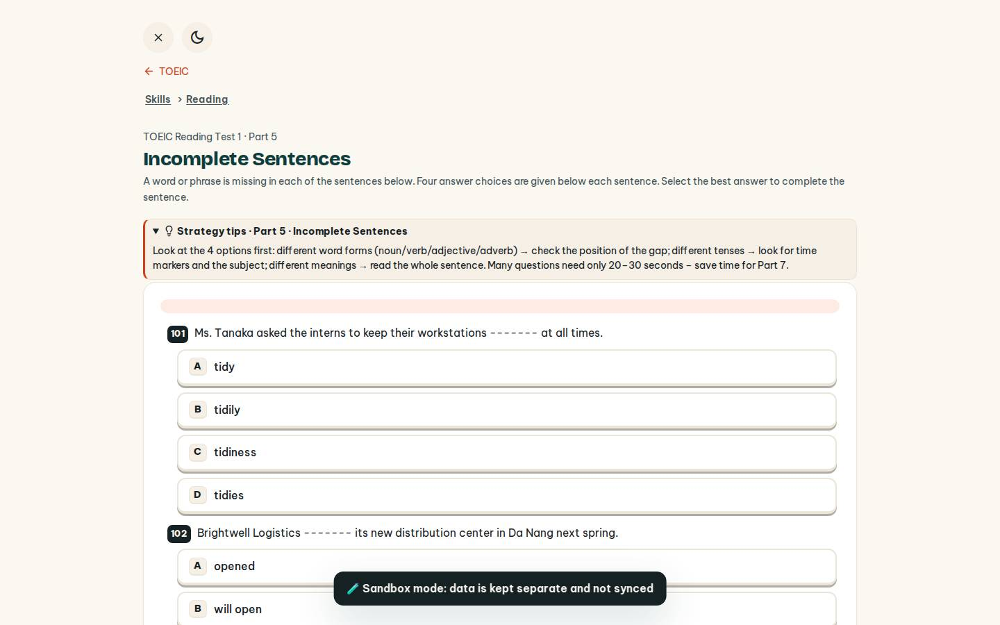
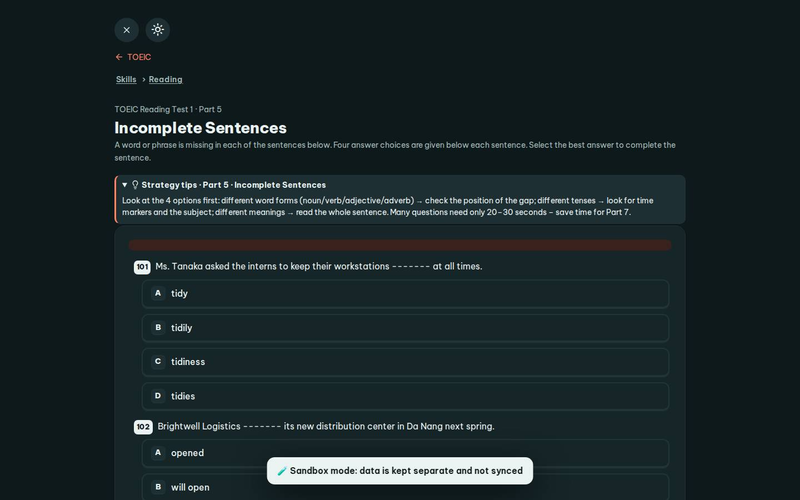

# #/toeic-r

Điểm: **83** · độ phủ 100 % · /toeic-r

- Chức năng: 100
- Lỗi JS: 100
- Rỗng/lỗi/tải: 100
- Back/Thoát: 100
- Tương phản: 100
- Chạm ≥44: 76
- Bố cục: 100
- i18n 15: 13
- Hiệu năng: 50
- Độ đẹp: 72

## Lỗi
- [tap] main#view>a.small – "TOEIC" vùng chạm 66×18 < 44px
- [tap] main#view>details.qtip>summary – "Strategy tips · Part 5 · Incomplete Sent" vùng chạm 1025×35 < 44px
- [tap] div.row>div.row>a.btn.sm – "Part 6" vùng chạm 73×36 < 44px
- [i18n] ar: thiếu dịch «to»
- [i18n] de: thiếu dịch «to»
- [i18n] es: thiếu dịch «to»
- [i18n] fr: thiếu dịch «to»
- [perf] LCP 8692 ms · CLS 0 · TBT 131 ms
- [beauty] Dark toast overlay obscures answer options
- [beauty] Generic web typography, lacks Duolingo's playful character
- [beauty] Flat, low-contrast buttons feel unfinished

## Ảnh
390l 
390d 
1440l 
1440d 
