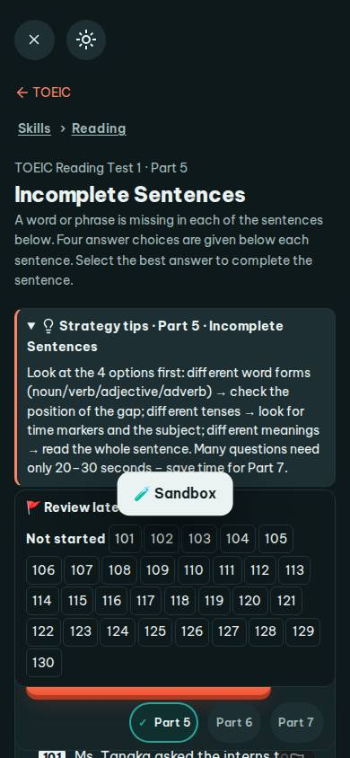
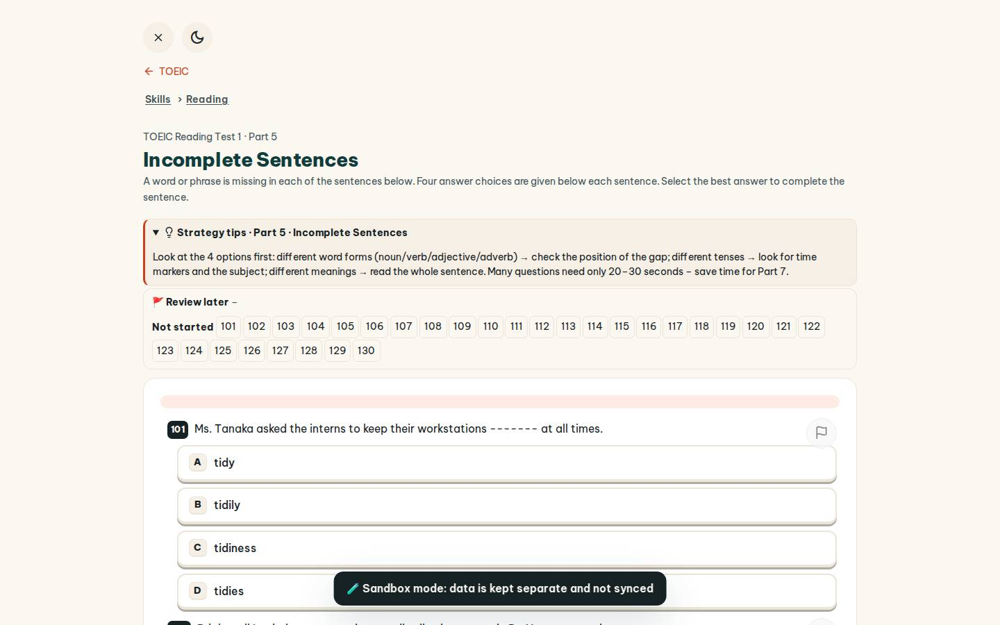

# #/toeic-r

Điểm: **85** · độ phủ 100 % · /toeic-r

- Chức năng: 100
- Lỗi JS: 100
- Rỗng/lỗi/tải: 100
- Back/Thoát: 100
- Tương phản: 100
- Chạm ≥44: 92
- Bố cục: 85
- i18n 15: 13
- Hiệu năng: 78
- Độ đẹp: 72

## Lỗi
- [tap] div.row>div.row>a.btn.sm – "Part 6" vùng chạm 73×36 < 44px
- [layout] div.qe-rv>span.qe-rv-g>button.qe-n – "130" rớt xuống đứng một mình ở dòng cuối của div#tq>div.qe-rv>span.qe-rv-g
- [i18n] ar: thiếu dịch «to»
- [i18n] de: thiếu dịch «to»
- [i18n] es: thiếu dịch «to»
- [i18n] fr: thiếu dịch «to»
- [perf] LCP 4044 ms · CLS 0.0007 · TBT 41 ms
- [beauty] Dark toast overlay obscures content, breaking visual flow
- [beauty] No primary CTA button; navigation is ambiguous
- [beauty] Generic web typography, lacks Duolingo's playful character

## Ảnh
390l 
390d 
1440l 
1440d 
