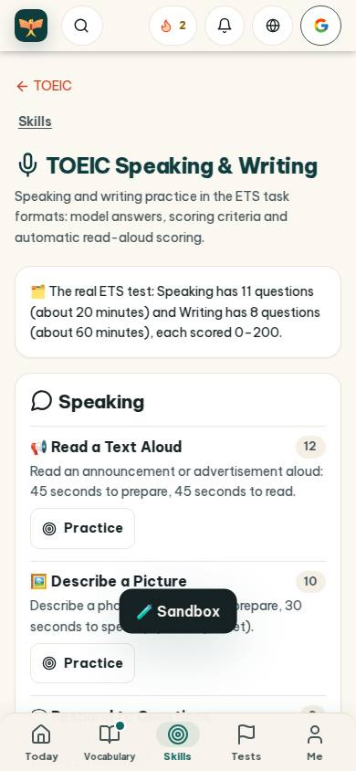
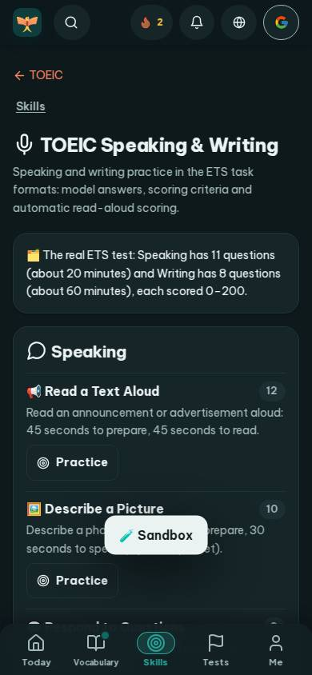
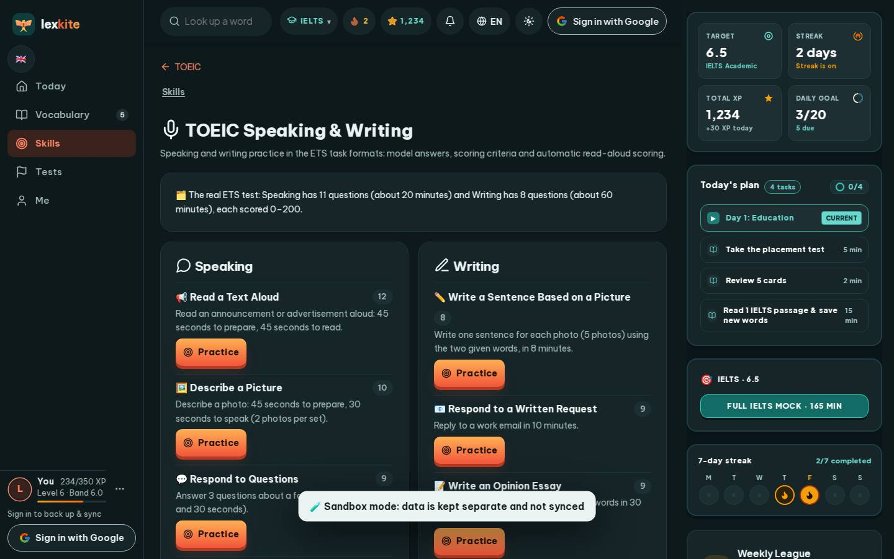

# #/toeic-sw

Điểm: **84** · độ phủ 100 % · /toeic-sw

- Chức năng: 100
- Lỗi JS: 100
- Rỗng/lỗi/tải: 100
- Back/Thoát: –
- Tương phản: 100
- Chạm ≥44: 100
- Bố cục: 100
- i18n 15: 13
- Hiệu năng: 50
- Độ đẹp: 81

## Lỗi
- [i18n] ar: thiếu dịch «Speaking» · thiếu dịch «Writing»
- [i18n] de: thiếu dịch «Speaking» · thiếu dịch «Writing»
- [i18n] es: thiếu dịch «Speaking» · thiếu dịch «Writing»
- [i18n] fr: thiếu dịch «Speaking» · thiếu dịch «Writing»
- [perf] LCP 9832 ms · CLS 0.0039 · TBT 69 ms
- [beauty] Dark 'Sandbox mode' banner breaks card rhythm and feels like a debug overlay.
- [beauty] Top nav mixes app icons with a raw Google 'G' logo, looking unpolished.
- [beauty] No character/illustration integration; layout is functional but generic compared to Duolingo.

## Ảnh
390l 
390d 
1440l 
1440d 
