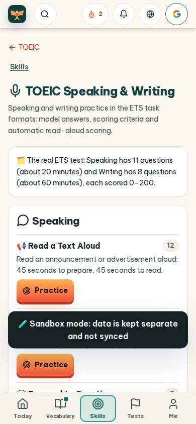
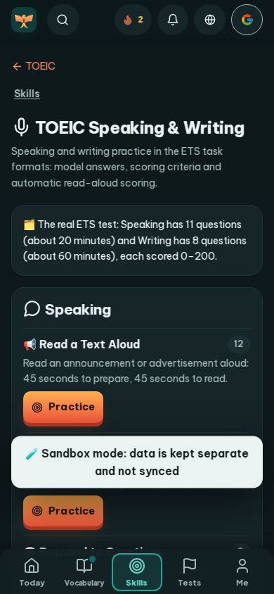
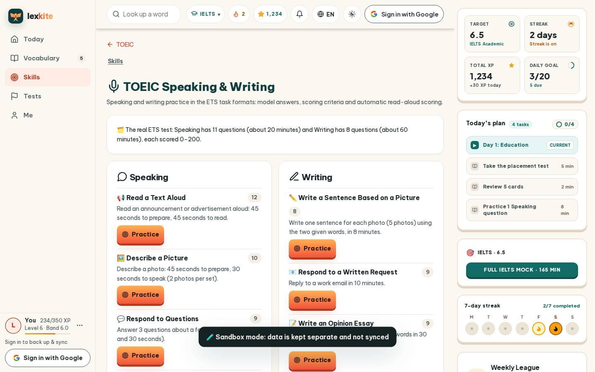
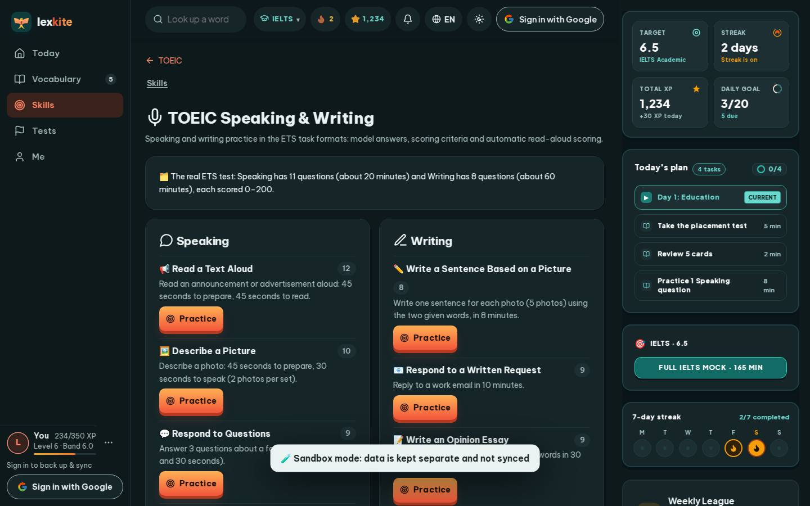

# #/toeic-sw

Điểm: **82** · độ phủ 100 % · /toeic-sw

- Chức năng: 100
- Lỗi JS: 100
- Rỗng/lỗi/tải: 100
- Back/Thoát: –
- Tương phản: 90
- Chạm ≥44: 92
- Bố cục: 100
- i18n 15: 13
- Hiệu năng: 50
- Độ đẹp: 77

## Lỗi
- [contrast] a[data-ext-cta="rail"]
- [tap] main#view>a.small – "TOEIC" vùng chạm 66×18 < 44px
- [i18n] ar: thiếu dịch «Speaking» · thiếu dịch «Writing»
- [i18n] de: thiếu dịch «Speaking» · thiếu dịch «Writing»
- [i18n] es: thiếu dịch «Speaking» · thiếu dịch «Writing»
- [i18n] fr: thiếu dịch «Speaking» · thiếu dịch «Writing»
- [perf] LCP 8528 ms · CLS 0.0031 · TBT 184 ms
- [beauty] Sandbox mode banner looks like a raw debug toast, not a polished UI element
- [beauty] Multiple orange Practice buttons compete for primary action focus
- [beauty] Generic emoji icons (mic, pencil) feel less polished than Duolingo's custom art

## Ảnh
390l 
390d 
1440l 
1440d 
