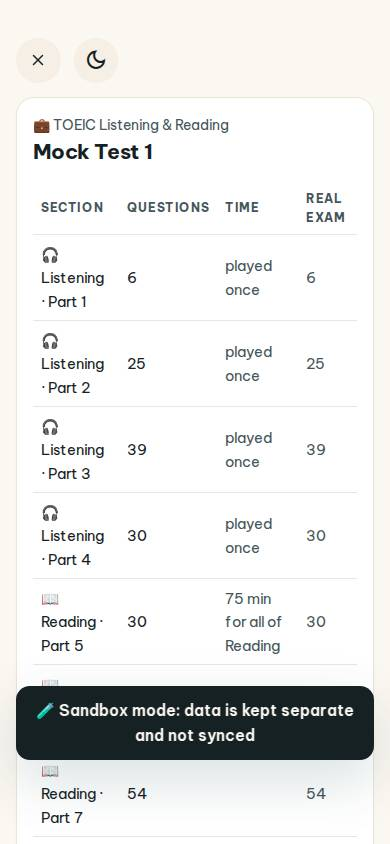
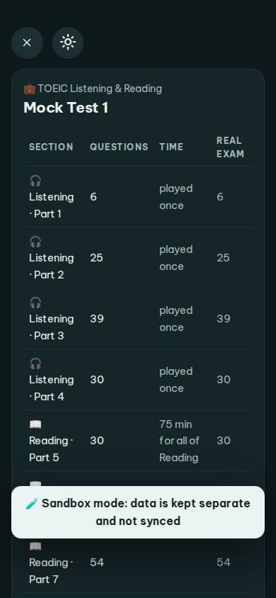
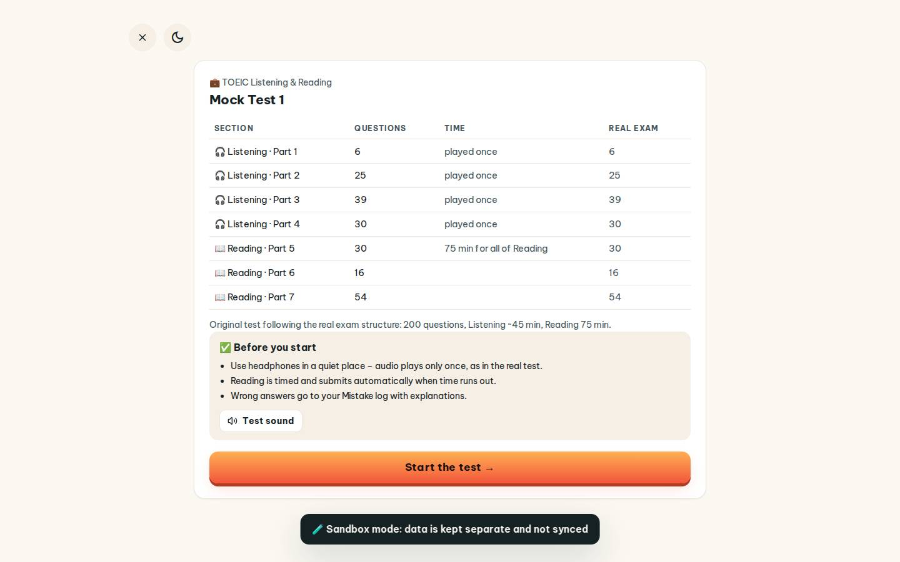
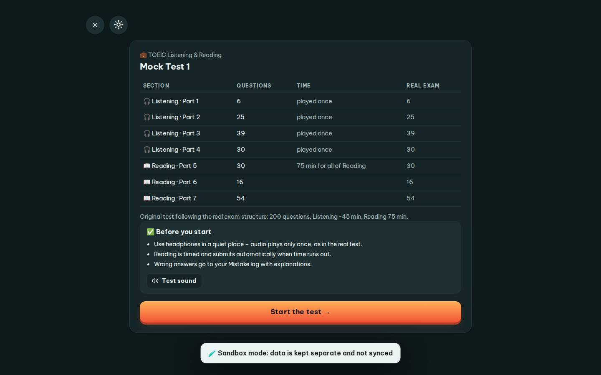

# #/toeic-test

Điểm: **92** · độ phủ 100 % · /toeic-test

- Chức năng: 100
- Lỗi JS: 100
- Rỗng/lỗi/tải: 100
- Back/Thoát: 100
- Tương phản: 100
- Chạm ≥44: 92
- Bố cục: 85
- i18n 15: 100
- Hiệu năng: 75
- Độ đẹp: 72

## Lỗi
- [tap] button#tTest – "Test sound" vùng chạm 133×36 < 44px
- [layout] button#tTest – "Test sound" rớt xuống đứng một mình ở dòng cuối của div.study-wrap>div.card.tx-start>div.tx-check
- [perf] LCP 4256 ms · CLS 0 · TBT 180 ms
- [beauty] No clear primary action or CTA button
- [beauty] Dense data table layout feels generic, not app-like
- [beauty] Toast notification overlaps content awkwardly

## Ảnh
390l 
390d 
1440l 
1440d 
