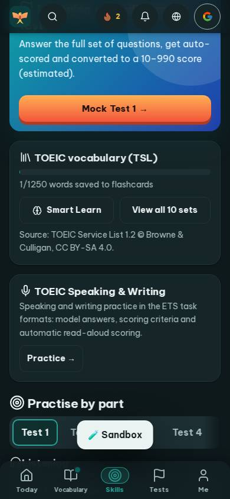

# #/toeic

Điểm: **87** · độ phủ 100 % · /toeic

- Chức năng: 100
- Lỗi JS: 100
- Rỗng/lỗi/tải: 100
- Back/Thoát: –
- Tương phản: 100
- Chạm ≥44: 76
- Bố cục: 70
- i18n 15: 100
- Hiệu năng: 50
- Độ đẹp: 72

## Lỗi
- [tap] div.card>div.row>a.btn.sm – "View all 10 sets" vùng chạm 168×36 < 44px
- [tap] main#view>div.tabs>a – "Test 1" vùng chạm 73×39 < 44px
- [tap] div.card>div.card-acts>a.btn.sm – "Listen once" vùng chạm 212×36 < 44px
- [layout] main#view>div.grid.g2>div.card.hero-main – nội dung tràn ngang 60px bị cắt
- [layout] main#view>div.tabs>a – "Test 10" rớt xuống đứng một mình ở dòng cuối của main#view>div.tabs
- [perf] LCP 15624 ms · CLS 0.0039 · TBT 100 ms
- [beauty] Dark overlay obscures card text, hurting readability.
- [beauty] Generic white buttons lack Duolingo's playful polish.
- [beauty] No character or illustration integration on main card.

## Ảnh
390l 
390d 
1440l 
1440d 
