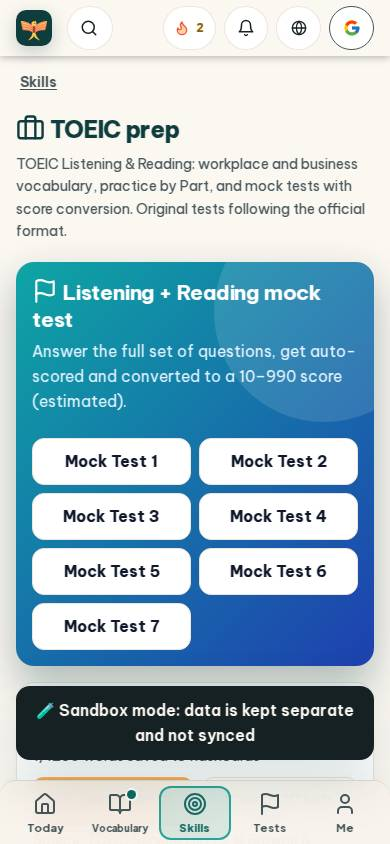
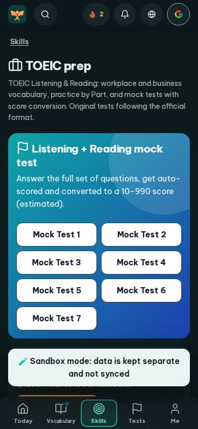
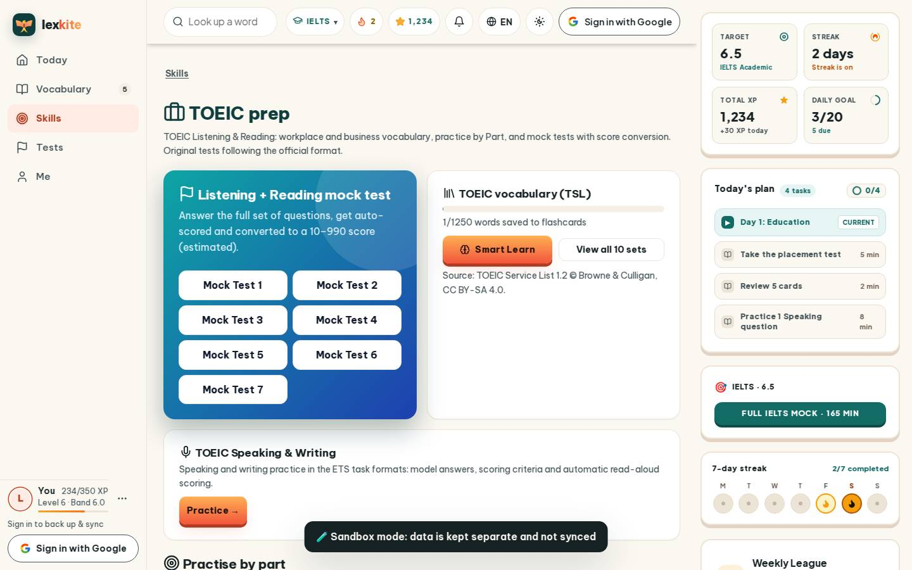
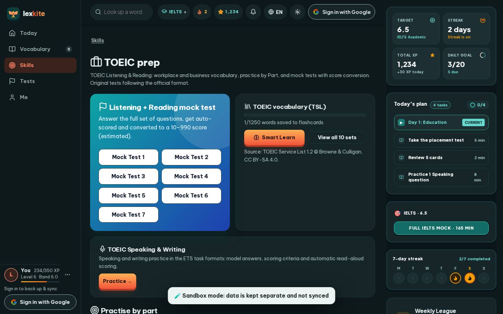

# #/toeic

Điểm: **79** · độ phủ 100 % · /toeic

- Chức năng: 100
- Lỗi JS: 100
- Rỗng/lỗi/tải: 100
- Back/Thoát: –
- Tương phản: 90
- Chạm ≥44: 76
- Bố cục: 85
- i18n 15: 13
- Hiệu năng: 50
- Độ đẹp: 72

## Lỗi
- [contrast] a[data-ext-cta="rail"]
- [tap] div.card>div.row>a.btn.sm – "View all 10 sets" vùng chạm 168×36 < 44px
- [tap] main#view>div.tabs>a – "Test 1" vùng chạm 73×39 < 44px
- [tap] div.card>div.card-acts>a.btn.sm – "Listen once" vùng chạm 212×36 < 44px
- [layout] main#view>div.grid.g2>div.card.hero-main – nội dung tràn ngang 60px bị cắt
- [i18n] ar: thiếu dịch «Listening» · thiếu dịch «Reading»
- [i18n] de: thiếu dịch «Listening» · thiếu dịch «Reading»
- [i18n] es: thiếu dịch «Listening» · thiếu dịch «Reading»
- [i18n] fr: thiếu dịch «Listening» · thiếu dịch «Reading»
- [perf] LCP 13488 ms · CLS 0.0033 · TBT 205 ms
- [beauty] Seven identical white buttons create visual clutter, lacking a single primary action.
- [beauty] Generic blue gradient card feels flat compared to Duolingo's vibrant, character-driven style.
- [beauty] Top navigation bar is crowded with too many distinct icons.

## Ảnh
390l 
390d 
1440l 
1440d 
