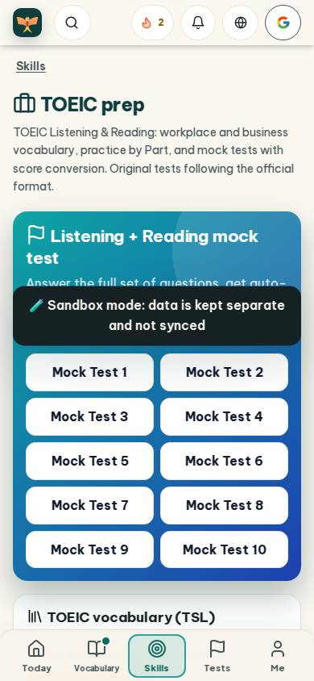
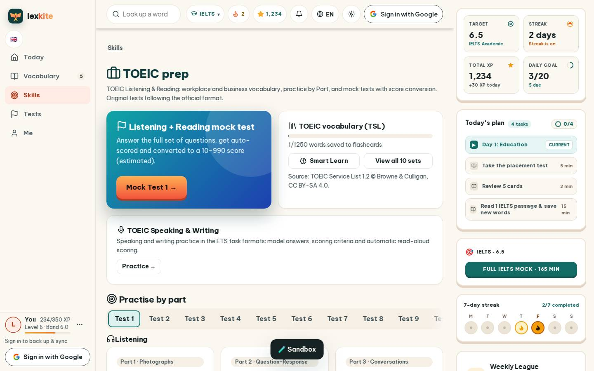

# #/toeic

Điểm: **91** · độ phủ 86 % · /toeic

- Chức năng: 100
- Lỗi JS: 100
- Rỗng/lỗi/tải: 100
- Back/Thoát: –
- Tương phản: 100
- Chạm ≥44: 76
- Bố cục: 85
- i18n 15: 100
- Hiệu năng: 50
- Độ đẹp: ∅

## Lỗi
- [tap] div.card>div.row>a.btn.sm – "Smart Learn" vùng chạm 173×36 < 44px
- [tap] main#view>div.tabs.fade-end>a – "Test 1" vùng chạm 77×41 < 44px
- [tap] div.card>div.card-acts>a.btn.sm – "Practice" vùng chạm 212×36 < 44px
- [layout] main#view>div.grid.g2>div.card.hero-main – nội dung tràn ngang 60px bị cắt
- [perf] LCP 15172 ms · CLS 0.0033 · TBT 136 ms

## Ảnh
390l 
390d 
1440l 
1440d 
