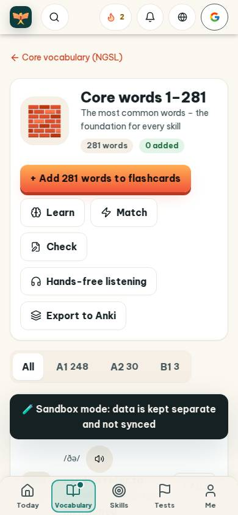
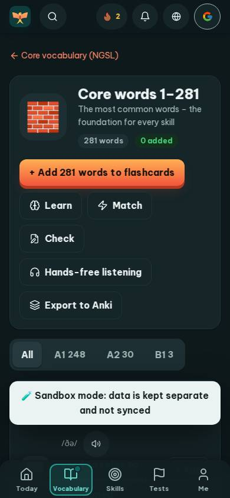
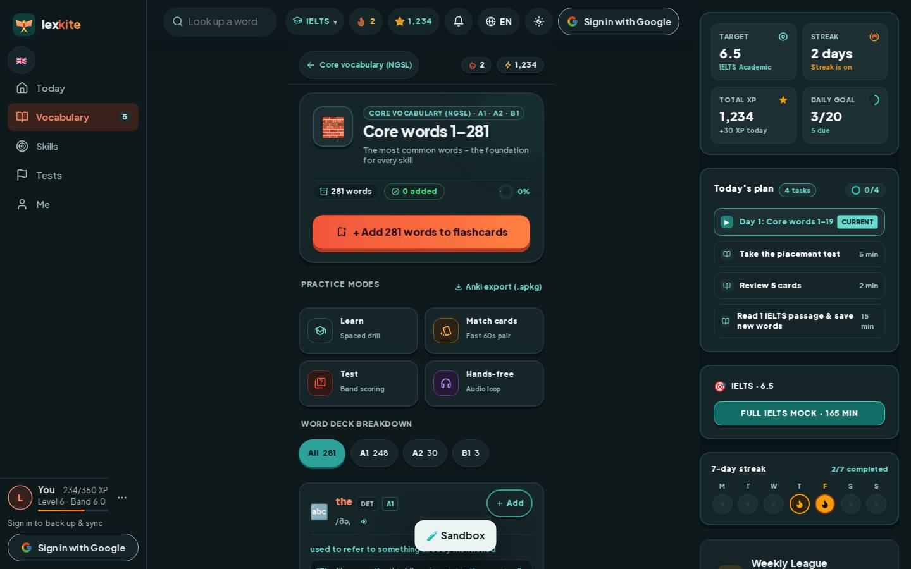

# #/topic/ngsl1

Điểm: **84** · độ phủ 100 % · /topic/ngsl1

- Chức năng: 100
- Lỗi JS: 100
- Rỗng/lỗi/tải: 100
- Back/Thoát: –
- Tương phản: 100
- Chạm ≥44: 76
- Bố cục: 85
- i18n 15: 13
- Hiệu năng: 68
- Độ đẹp: 82

## Lỗi
- [tap] div#lvTabs>button – "All" vùng chạm 50×41 < 44px
- [tap] div>div.row>a.w – "the" vùng chạm 30×27 < 44px
- [tap] div.word-row>div>button.btn.sm – "+ Add" vùng chạm 70×36 < 44px
- [layout] div>div.row>button.icon-btn.sm – "Pronounce" rớt xuống đứng một mình ở dòng cuối của div.word-row>div>div.row
- [i18n] ar: thiếu dịch «to» · thiếu dịch «All»
- [i18n] de: thiếu dịch «to» · thiếu dịch «All»
- [i18n] es: thiếu dịch «to» · thiếu dịch «All»
- [i18n] fr: thiếu dịch «to» · thiếu dịch «All»
- [perf] LCP 3492 ms · CLS 0.0039 · TBT 776 ms
- [beauty] Sandbox mode banner is visually heavy and interrupts flow
- [beauty] Top nav icons feel generic and unbranded
- [beauty] Button row alignment is slightly uneven

## Ảnh
390l 
390d 
1440l 
1440d 
