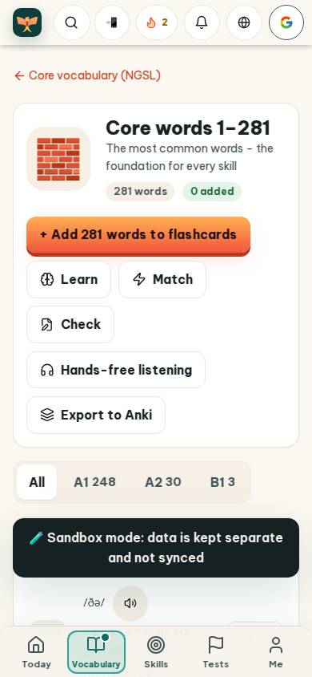
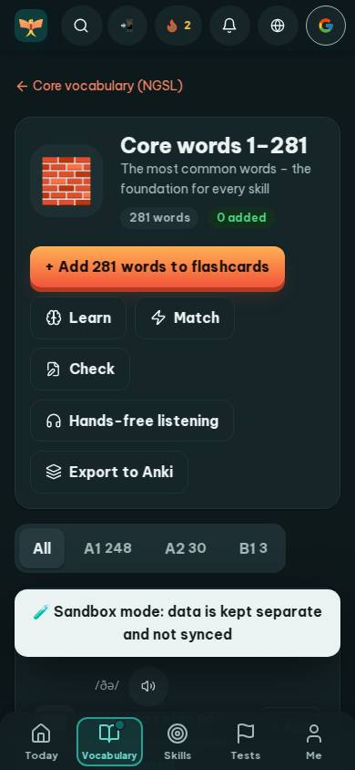
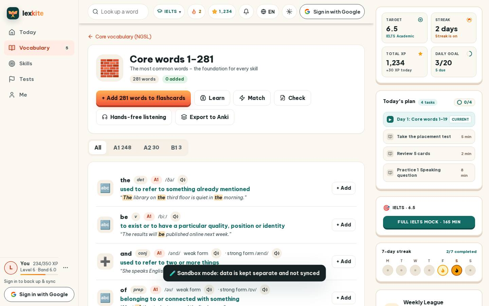
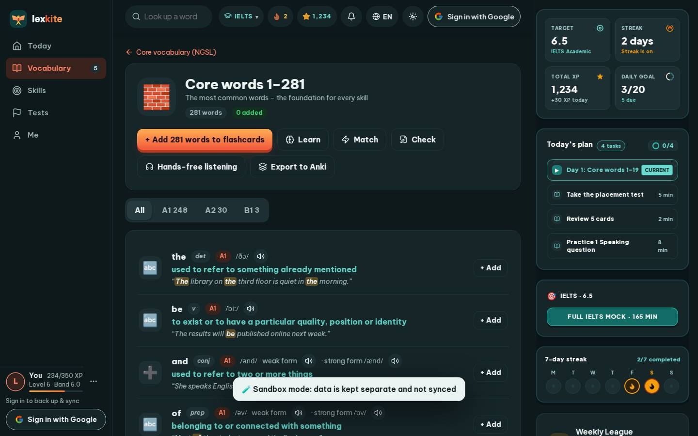

# #/topic/ngsl1

Điểm: **83** · độ phủ 100 % · /topic/ngsl1

- Chức năng: 100
- Lỗi JS: 100
- Rỗng/lỗi/tải: 100
- Back/Thoát: –
- Tương phản: 100
- Chạm ≥44: 68
- Bố cục: 85
- i18n 15: 13
- Hiệu năng: 60
- Độ đẹp: 83

## Lỗi
- [tap] main#view>a.small – "Core vocabulary (NGSL)" vùng chạm 188×18 < 44px
- [tap] div#lvTabs>button – "All" vùng chạm 50×41 < 44px
- [tap] div>div.row>a.w – "the" vùng chạm 30×27 < 44px
- [tap] div.word-row>div>button.btn.sm – "+ Add" vùng chạm 70×36 < 44px
- [layout] div>div.row>button.icon-btn.sm – "Pronounce" rớt xuống đứng một mình ở dòng cuối của div.word-row>div>div.row
- [i18n] ar: thiếu dịch «to» · thiếu dịch «All»
- [i18n] de: thiếu dịch «to» · thiếu dịch «All»
- [i18n] es: thiếu dịch «to» · thiếu dịch «All»
- [i18n] fr: thiếu dịch «to» · thiếu dịch «All»
- [perf] LCP 4040 ms · CLS 0.0031 · TBT 780 ms
- [beauty] Top nav bar is a cluttered row of generic circular icons, breaking the clean app aesthetic.
- [beauty] The dark 'Sandbox mode' banner is a heavy, utilitarian block that feels out of place and unpolished.
- [beauty] The brick icon is a flat, generic clip-art asset rather than a custom, integrated illustration.

## Ảnh
390l 
390d 
1440l 
1440d 
