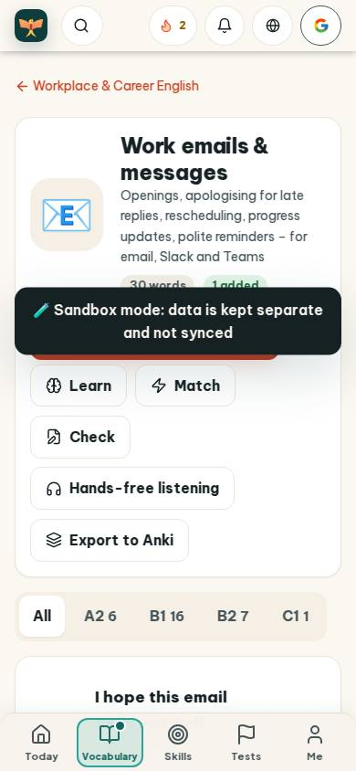
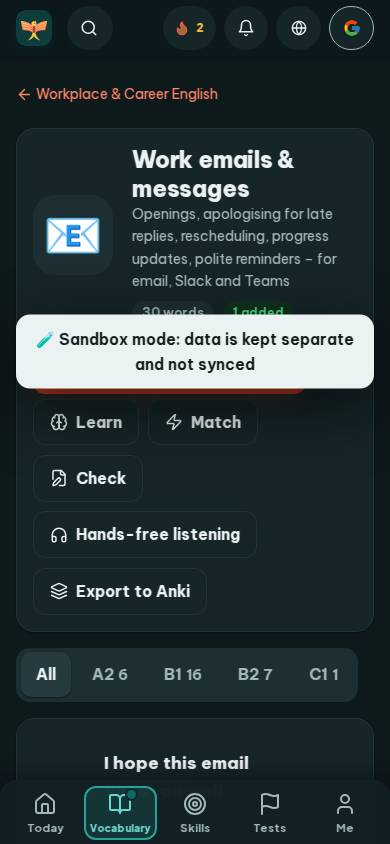
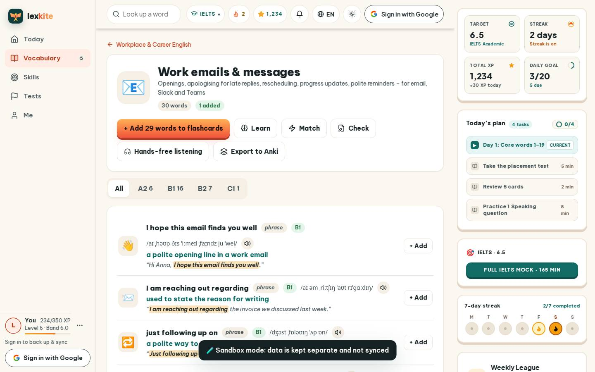
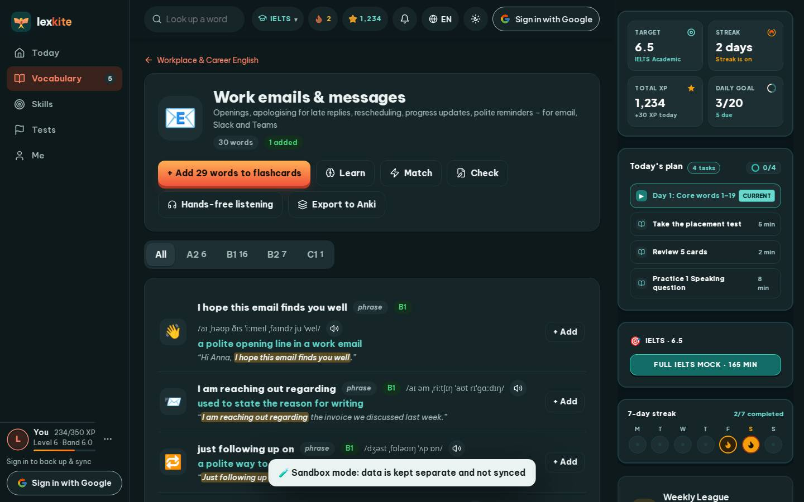

# #/topic/office-email

Điểm: **79** · độ phủ 100 % · /topic/office-email

- Chức năng: 100
- Lỗi JS: 100
- Rỗng/lỗi/tải: 100
- Back/Thoát: –
- Tương phản: 90
- Chạm ≥44: 68
- Bố cục: 85
- i18n 15: 13
- Hiệu năng: 50
- Độ đẹp: 74

## Lỗi
- [contrast] .word-row:nth-child(19) > div:nth-child(2) > .ex.small > mark
- [tap] main#view>a.small – "Workplace & Career English" vùng chạm 205×18 < 44px
- [tap] div#lvTabs>button – "All" vùng chạm 50×41 < 44px
- [tap] div>div.row>a.w – "I hope this email finds you well" vùng chạm 268×27 < 44px
- [tap] div.word-row>div>button.btn.sm – "+ Add" vùng chạm 70×36 < 44px
- [layout] div>div.row>button.icon-btn.sm – "Pronounce" rớt xuống đứng một mình ở dòng cuối của div.word-row>div>div.row
- [i18n] ar: thiếu dịch «phrase»
- [i18n] de: thiếu dịch «phrase»
- [i18n] es: thiếu dịch «phrase»
- [i18n] fr: thiếu dịch «phrase»
- [perf] LCP 9820 ms · CLS 0.0033 · TBT 16 ms
- [beauty] Dark toast obscures primary CTA and card content
- [beauty] Generic outline buttons lack Duolingo's bold, filled primary action
- [beauty] Uneven vertical spacing between action button rows

## Ảnh
390l 
390d 
1440l 
1440d 
