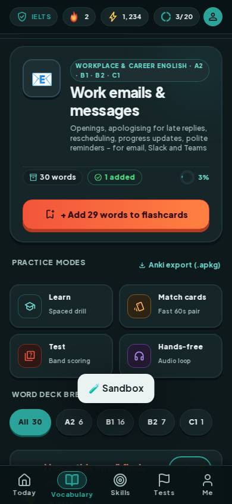
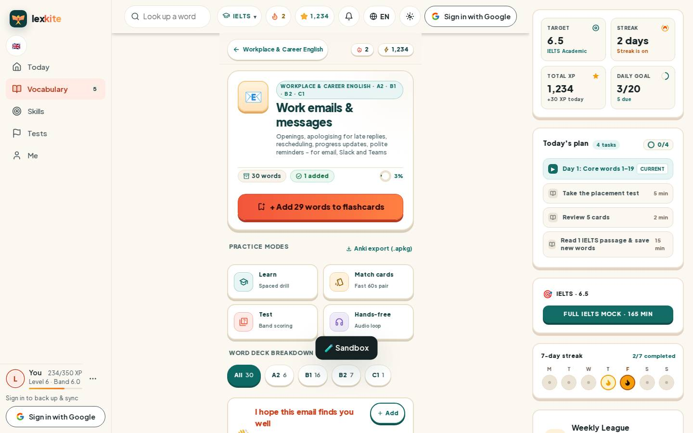

# #/topic/office-email

Điểm: **80** · độ phủ 100 % · /topic/office-email

- Chức năng: 100
- Lỗi JS: 100
- Rỗng/lỗi/tải: 100
- Back/Thoát: –
- Tương phản: 90
- Chạm ≥44: 76
- Bố cục: 85
- i18n 15: 13
- Hiệu năng: 48
- Độ đẹp: 77

## Lỗi
- [contrast] .word-row:nth-child(19) > div:nth-child(2) > .ex.small > mark
- [tap] div#lvTabs>button – "All" vùng chạm 50×41 < 44px
- [tap] div>div.row>a.w – "I hope this email finds you well" vùng chạm 268×27 < 44px
- [tap] div.word-row>div>button.btn.sm – "+ Add" vùng chạm 70×36 < 44px
- [layout] div>div.row>button.icon-btn.sm – "Pronounce" rớt xuống đứng một mình ở dòng cuối của div.word-row>div>div.row
- [i18n] ar: thiếu dịch «phrase»
- [i18n] de: thiếu dịch «phrase»
- [i18n] es: thiếu dịch «phrase»
- [i18n] fr: thiếu dịch «phrase»
- [perf] LCP 10232 ms · CLS 0.004 · TBT 253 ms
- [beauty] Dark toast overlaps and hides the primary CTA button
- [beauty] Action buttons are inconsistent: some are pills, others are full-width rows
- [beauty] Generic line icons feel less polished than Duolingo's character-driven style

## Ảnh
390l 
390d 
1440l 
1440d 
