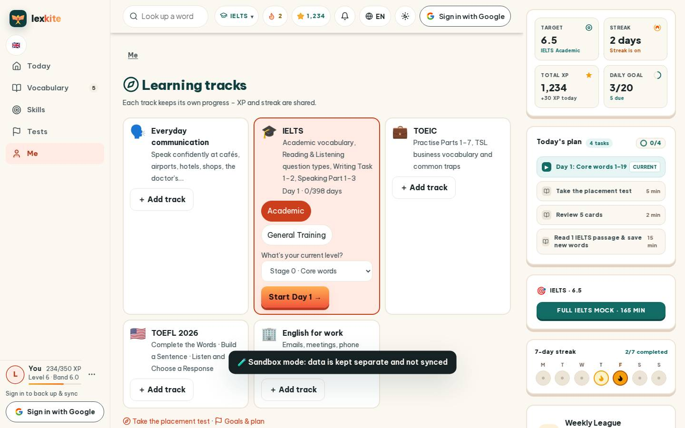
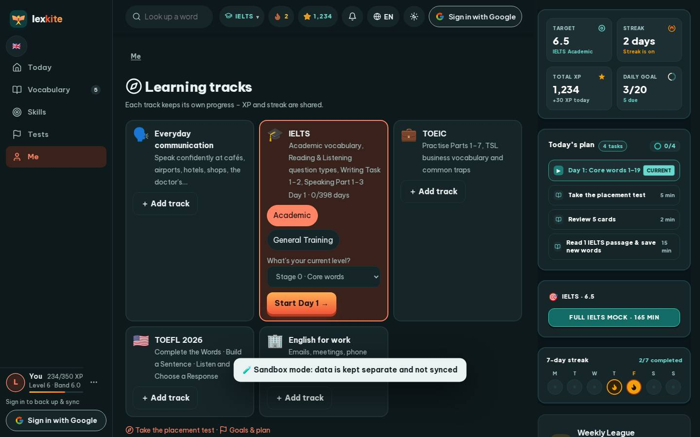

# #/tracks

Điểm: **92** · độ phủ 100 % · /tracks

- Chức năng: 100
- Lỗi JS: 100
- Rỗng/lỗi/tải: 100
- Back/Thoát: –
- Tương phản: 100
- Chạm ≥44: 100
- Bố cục: 100
- i18n 15: 100
- Hiệu năng: 50
- Độ đẹp: 74

## Lỗi
- [perf] LCP 7204 ms · CLS 0.004 · TBT 35 ms
- [beauty] Dark 'Sandbox mode' banner looks like a raw debug overlay, not a polished UI element.
- [beauty] Top nav mixes app icons with a foreign Google 'G' logo, breaking visual cohesion.
- [beauty] Card content density is uneven; IELTS card feels cramped compared to the sparse first card.

## Ảnh
390l 
390d 
1440l 
1440d 
