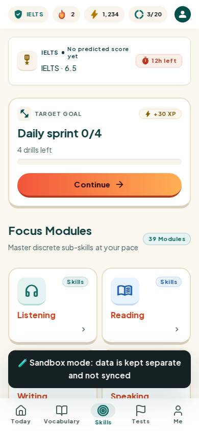
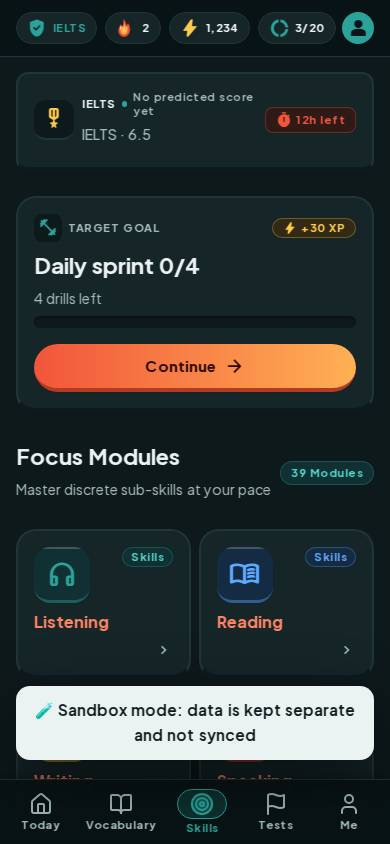
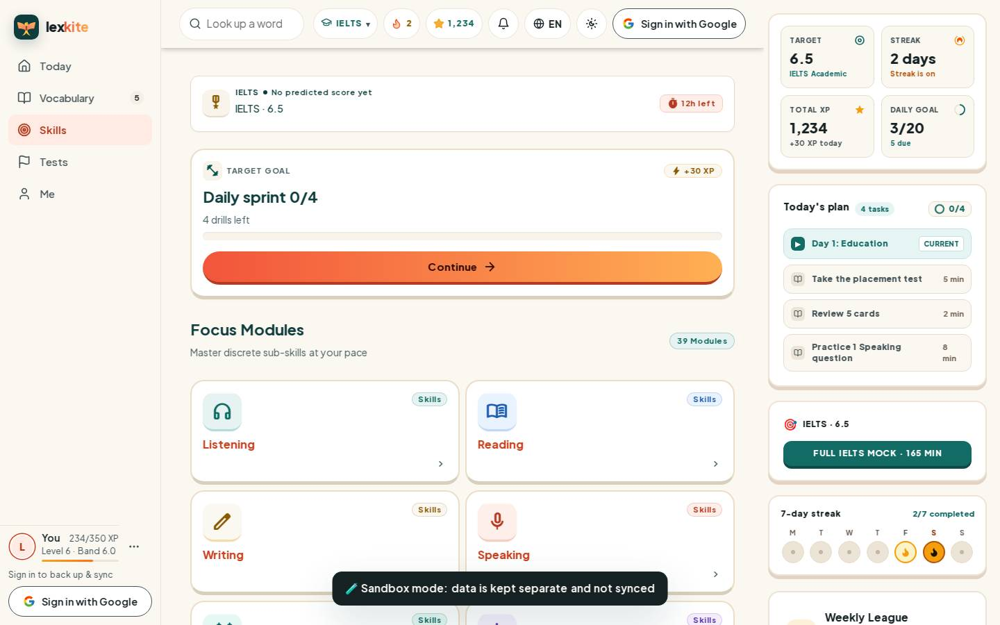
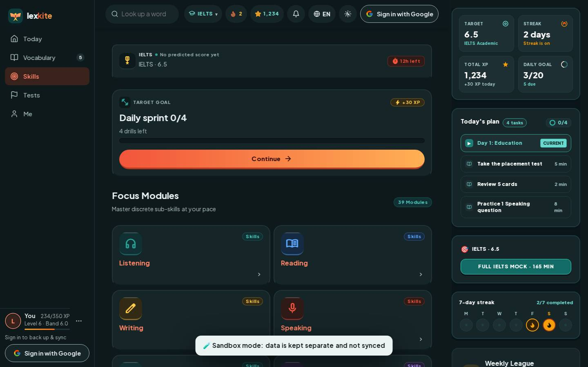

# #/train

Điểm: **95** · độ phủ 100 % · /train

- Chức năng: 100
- Lỗi JS: 100
- Rỗng/lỗi/tải: 100
- Back/Thoát: –
- Tương phản: 100
- Chạm ≥44: 92
- Bố cục: 100
- i18n 15: 100
- Hiệu năng: 83
- Độ đẹp: 82

## Lỗi
- [tap] div>h4.text-[22px].tracking-[0em]>a.after:absolute.after:inset-0 – "Listening" vùng chạm 75×21 < 44px
- [perf] LCP 3720 ms · CLS 0 · TBT 177 ms
- [beauty] Dark 'Sandbox mode' banner looks like a raw debug toast, breaking visual polish.
- [beauty] Top status bar icons feel generic and less cohesive than Duolingo's character-driven style.
- [beauty] No character or mascot integration; layout is clean but visually generic.

## Ảnh
390l 
390d 
1440l 
1440d 
