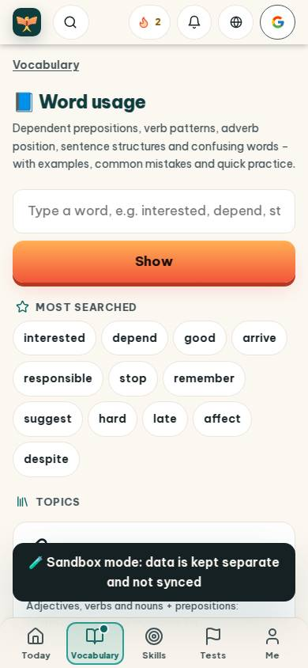
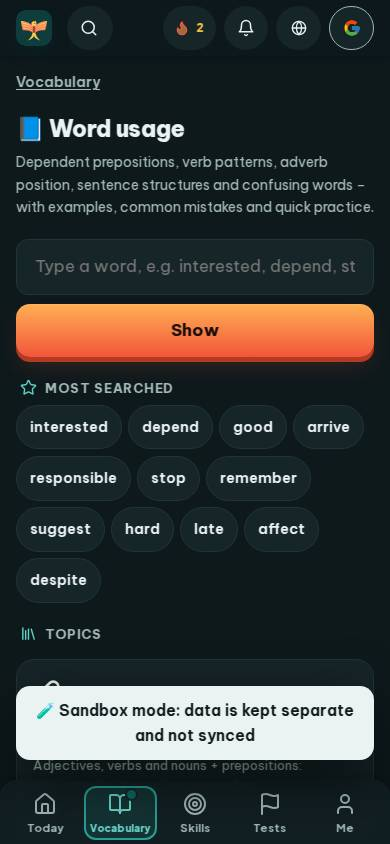
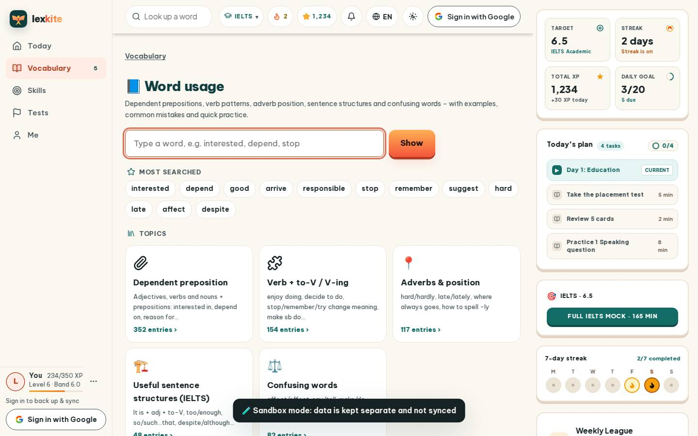
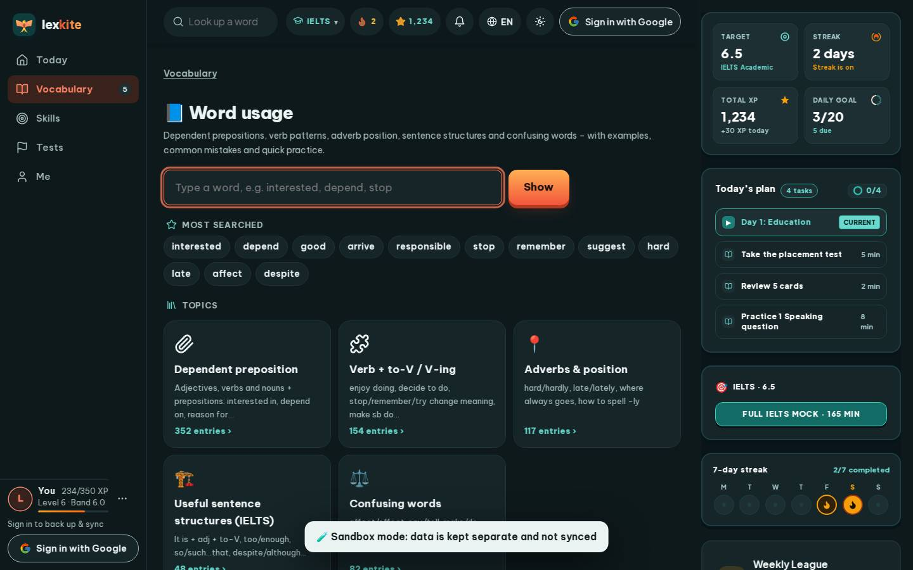

# #/usage

Điểm: **91** · độ phủ 100 % · /usage

- Chức năng: 100
- Lỗi JS: 100
- Rỗng/lỗi/tải: 100
- Back/Thoát: –
- Tương phản: 100
- Chạm ≥44: 92
- Bố cục: 85
- i18n 15: 100
- Hiệu năng: 59
- Độ đẹp: 78

## Lỗi
- [tap] main#view>div.us-chips>a – "interested" vùng chạm 106×36 < 44px
- [layout] main#view>div.us-chips>a – "despite" rớt xuống đứng một mình ở dòng cuối của main#view>div.us-chips
- [perf] LCP 5368 ms · CLS 0.0031 · TBT 22 ms
- [beauty] Dark toast notification obscures content and breaks layout flow
- [beauty] Generic orange button lacks Duolingo's playful, rounded character style
- [beauty] Top nav icons feel cluttered and inconsistently spaced

## Ảnh
390l 
390d 
1440l 
1440d 
