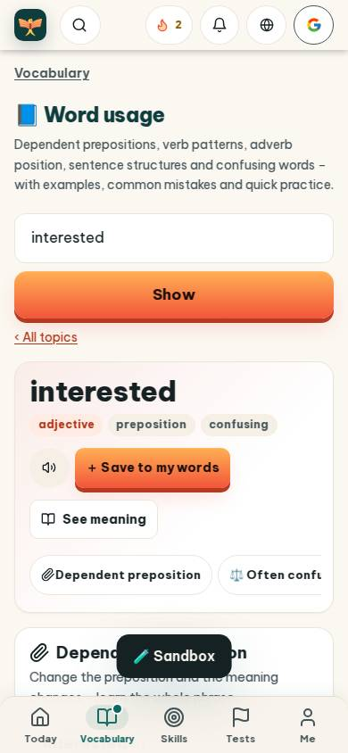
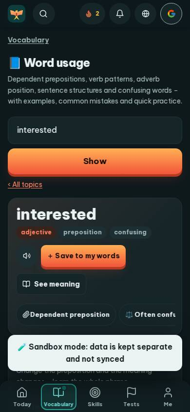
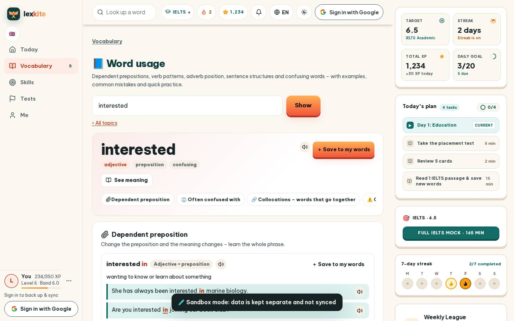
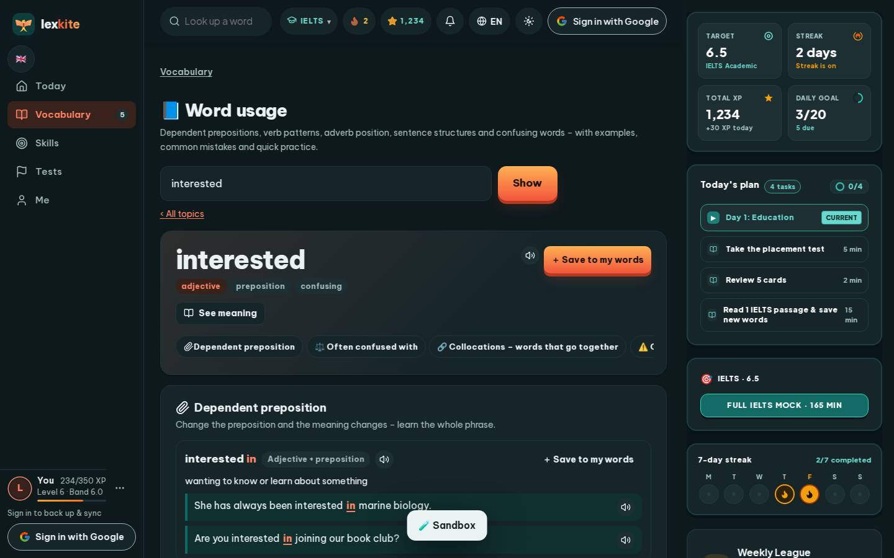

# #/usage/interested

Điểm: **85** · độ phủ 86 % · /usage/interested

- Chức năng: 100
- Lỗi JS: 100
- Rỗng/lỗi/tải: 100
- Back/Thoát: –
- Tương phản: 100
- Chạm ≥44: 28
- Bố cục: 40
- i18n 15: 100
- Hiệu năng: 59
- Độ đẹp: ∅

## Lỗi
- [tap] main#view>p.small>a – "‹ All topics" vùng chạm 71×18 < 44px
- [tap] section.card.us-hero>div.us-acts>a.btn.sm – "See meaning" vùng chạm 144×36 < 44px
- [tap] section.card.us-hero>nav.us-jump>a – "Dependent preposition" vùng chạm 205×36 < 44px
- [tap] div.us-it>div.us-ih>button.btn.sm – "＋ Save to my words" vùng chạm 173×36 < 44px
- [tap] tr>th>a – "interested" vùng chạm 81×19 < 44px
- [layout] main#view>section.card.us-hero>nav.us-jump – nội dung tràn ngang 842px bị cắt: "⚖️ Often confused with", "🔗 Collocations – words that go to
- [layout] section.card.us-hero>nav.us-jump>a – "⚖️ Often confused with" lòi ra ngoài main#view>section.card.us-hero 62px
- [layout] section#usQz>ol.us-qs>li.us-q – "History is blank . A interesting B inter" lòi ra ngoài section#usQz 18px
- [layout] section.card.us-hero>nav.us-jump>a – "⚖️ Often confused with" nằm ngoài màn hình (x 244…436 / 390)
- [perf] LCP 5380 ms · CLS 0.0033 · TBT 43 ms

## Ảnh
390l 
390d 
1440l 
1440d 
