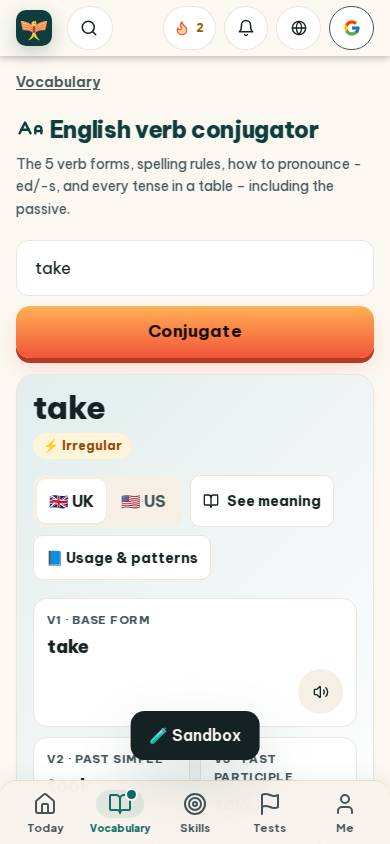
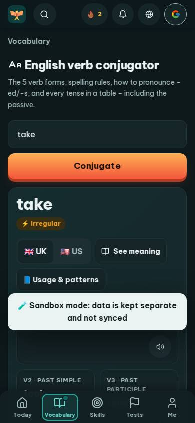
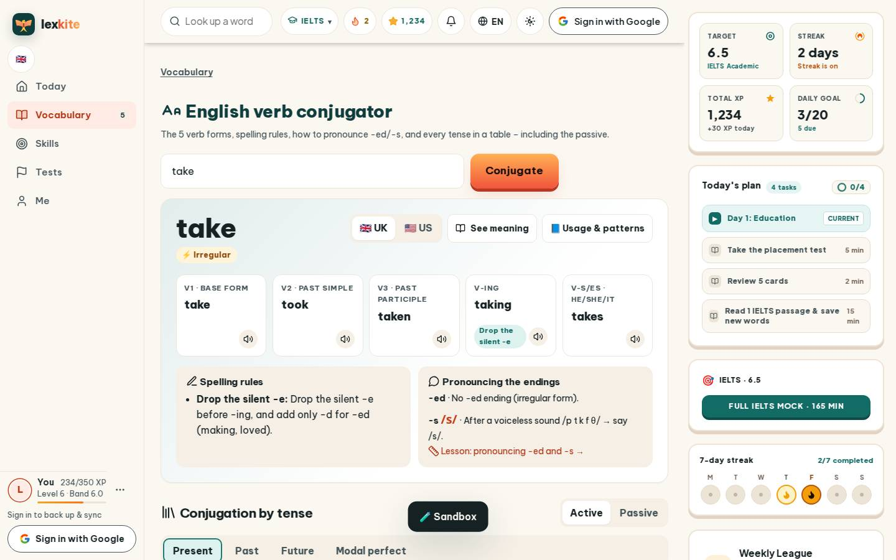
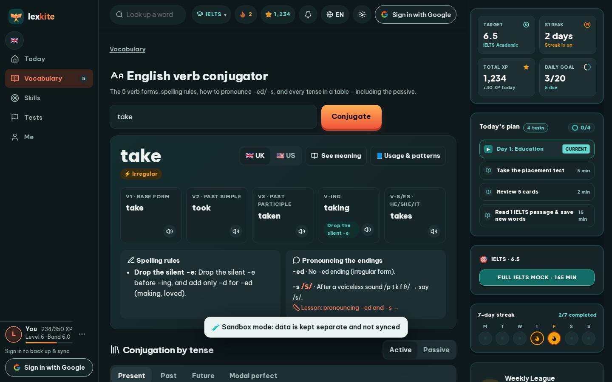

# #/verb/take

Điểm: **91** · độ phủ 86 % · /verb/take

- Chức năng: 100
- Lỗi JS: 100
- Rỗng/lỗi/tải: 100
- Back/Thoát: –
- Tương phản: 100
- Chạm ≥44: 20
- Bố cục: 100
- i18n 15: 100
- Hiệu năng: 60
- Độ đẹp: ∅

## Lỗi
- [tap] div#vbReg>button – "🇬🇧 UK" vùng chạm 69×38 < 44px
- [tap] div.vb-grid2>div.vb-box>a.small – "Lesson: pronouncing -ed and -s →" vùng chạm 251×18 < 44px
- [tap] div#vbVoice>button – "Active" vùng chạm 77×38 < 44px
- [tap] button#vbt-present – "Present" vùng chạm 94×41 < 44px
- [tap] button#vbt-past – "Past" vùng chạm 68×41 < 44px
- [perf] LCP 5328 ms · CLS 0.0033 · TBT 78 ms

## Ảnh
390l 
390d 
1440l 
1440d 
