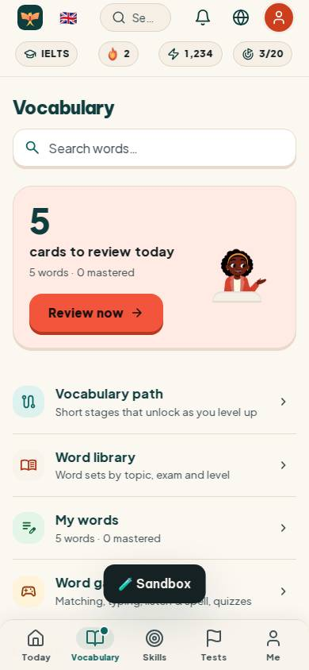
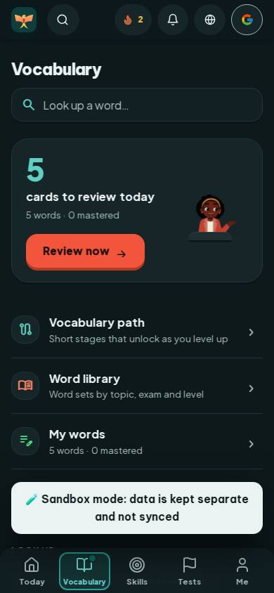
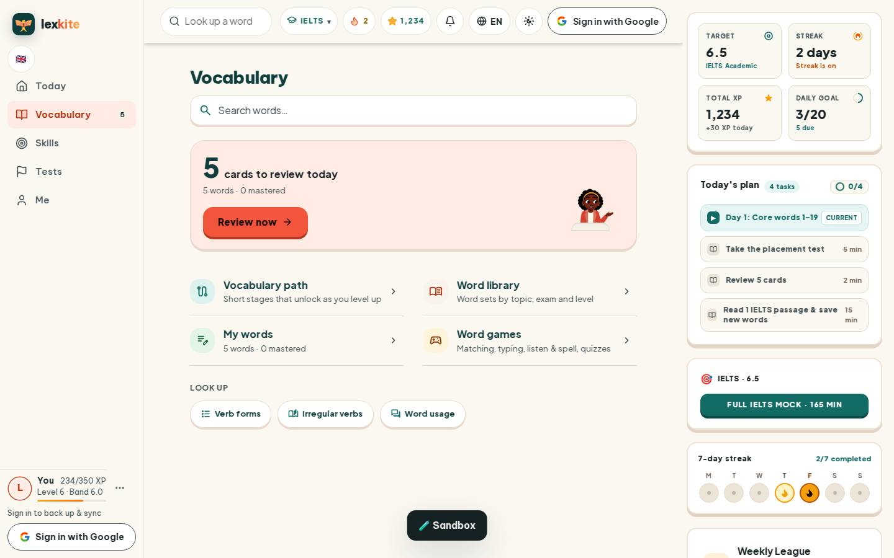
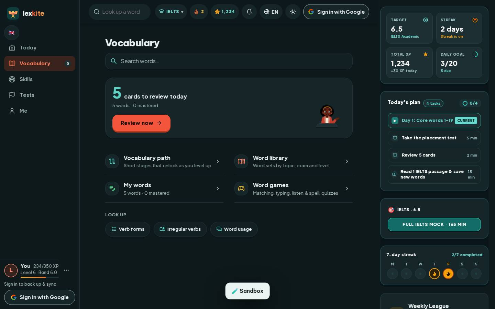

# #/vocab

Điểm: **97** · độ phủ 100 % · /vocab

- Chức năng: 100
- Lỗi JS: 100
- Rỗng/lỗi/tải: 100
- Back/Thoát: –
- Tương phản: 100
- Chạm ≥44: 100
- Bố cục: 100
- i18n 15: 100
- Hiệu năng: 86
- Độ đẹp: 86

## Lỗi
- [perf] LCP 3492 ms · CLS 0.0039 · TBT 82 ms
- [beauty] Sandbox mode banner is a raw, high-contrast black block that breaks the soft visual theme.
- [beauty] Top navigation icons (streak, bell, globe, Google) feel crowded and lack consistent spacing.
- [beauty] Sandbox mode banner is a raw, high-contrast white block that breaks the dark theme

## Ảnh
390l 
390d 
1440l 
1440d 
