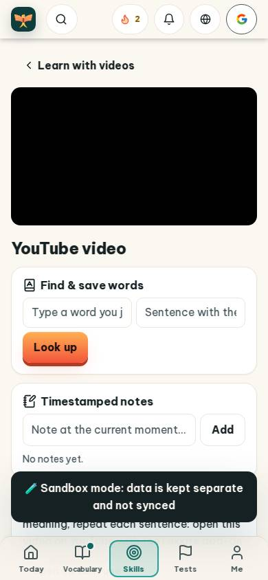
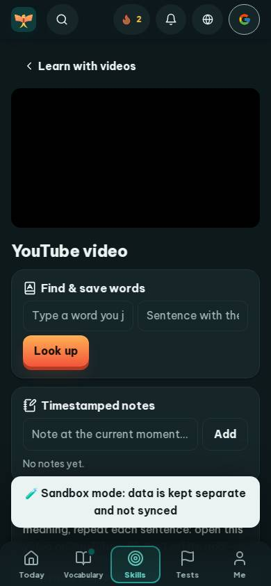
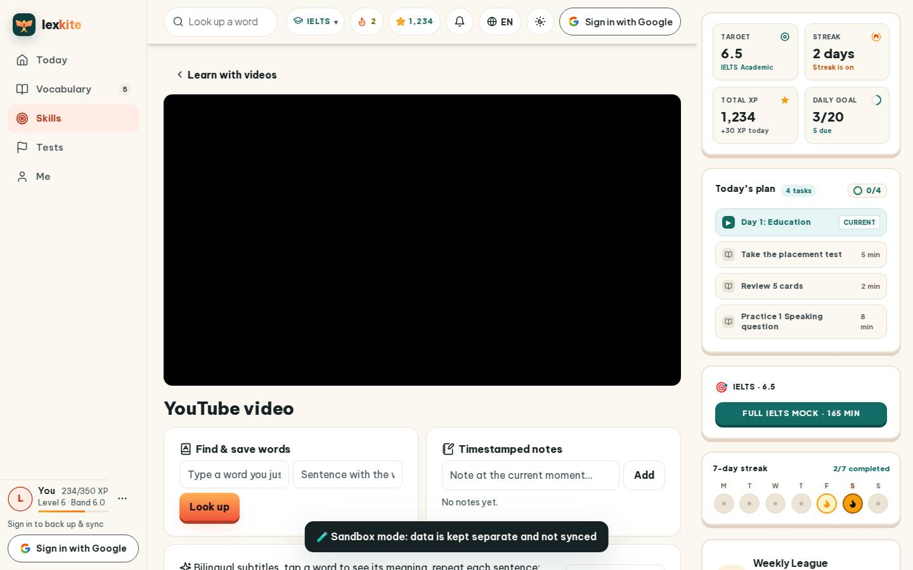
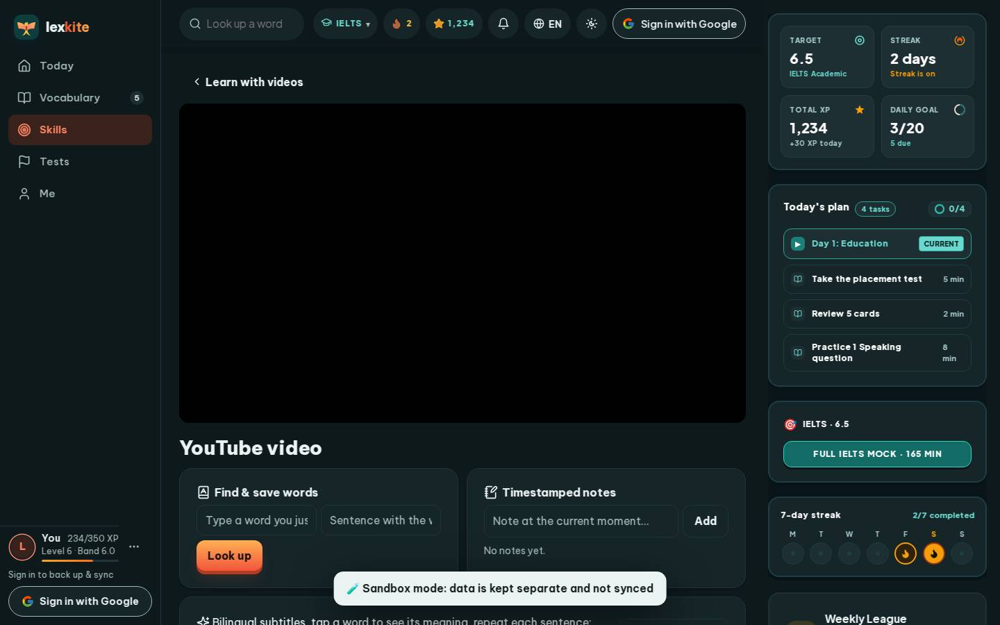

# #/watch

Điểm: **90** · độ phủ 100 % · /watch/M7lc1UVf-VE

- Chức năng: 100
- Lỗi JS: 100
- Rỗng/lỗi/tải: 100
- Back/Thoát: –
- Tương phản: 100
- Chạm ≥44: 92
- Bố cục: 85
- i18n 15: 100
- Hiệu năng: 62
- Độ đẹp: 67

## Lỗi
- [tap] a#wtYT – "Open on YouTube" vùng chạm 157×36 < 44px
- [layout] form#wtSave>button.btn.primary – "Look up" rớt xuống đứng một mình ở dòng cuối của form#wtSave
- [perf] LCP 5144 ms · CLS 0.0031 · TBT 13 ms
- [beauty] Large black rectangle is a broken/empty video player, not an illustration
- [beauty] Toast banner overlaps and hides the 'Training' card content
- [beauty] Input placeholders are truncated ('Type a word you j')

## Ảnh
390l 
390d 
1440l 
1440d 
