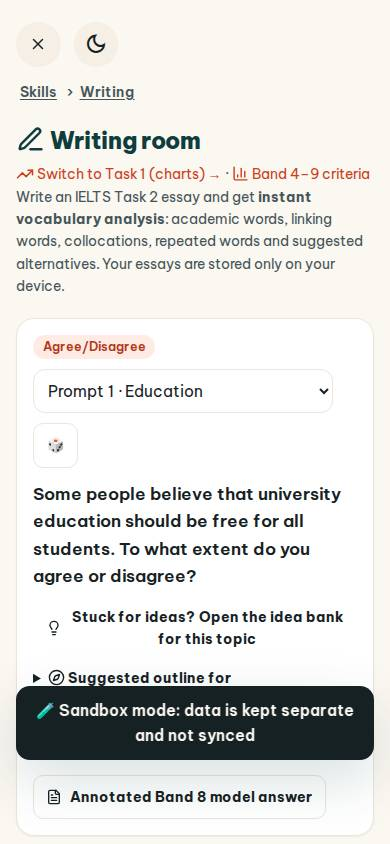
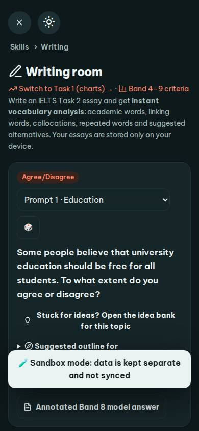
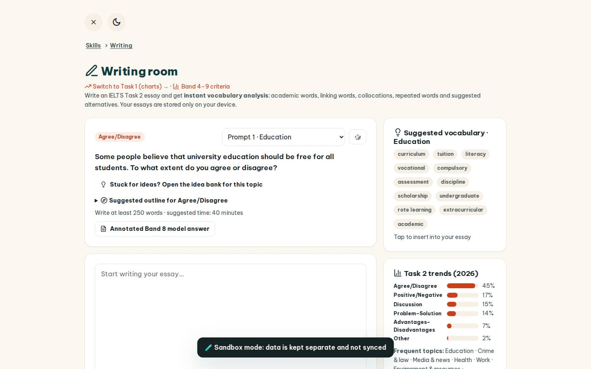
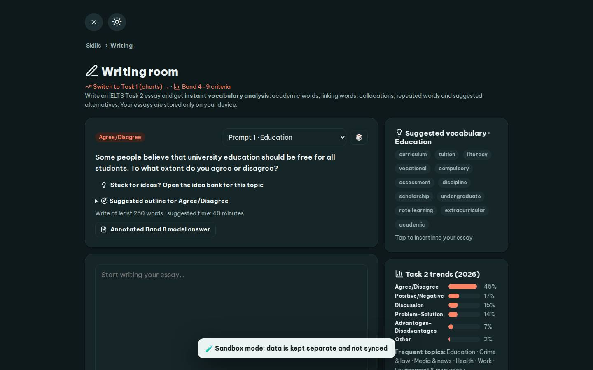

# #/write

Điểm: **88** · độ phủ 100 % · /write

- Chức năng: 100
- Lỗi JS: 100
- Rỗng/lỗi/tải: 100
- Back/Thoát: 100
- Tương phản: 100
- Chạm ≥44: 44
- Bố cục: 85
- i18n 15: 100
- Hiệu năng: 50
- Độ đẹp: 72

## Lỗi
- [tap] button#rndP – "🎲" vùng chạm 43×36 < 44px
- [tap] div.stack>div.card>a.btn.sm – "Stuck for ideas? Open the idea bank for " vùng chạm 422×36 < 44px
- [tap] div.card>details>summary.small – "Suggested outline for Agree/Disagree" vùng chạm 663×22 < 44px
- [tap] div.card>div.row.between>a.btn.sm – "Annotated Band 8 model answer" vùng chạm 293×36 < 44px
- [tap] button#tBtn – "Start timer" vùng chạm 133×36 < 44px
- [layout] select#pSel – select "Prompt 1 · Education" không có nhãn nhìn thấy – người học không biết ô này để làm gì
- [perf] LCP 7756 ms · CLS 0 · TBT 178 ms
- [beauty] No clear primary action button (CTA)
- [beauty] Dense text block lacks visual hierarchy
- [beauty] Generic UI, lacks Duolingo-style character/illustration

## Ảnh
390l 
390d 
1440l 
1440d 
