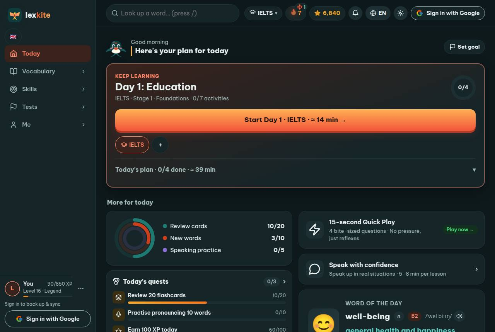

# Add-on › app #/home

Điểm: **92** · độ phủ 68 % · app/index.html?demo=1&hl=en#/home

- Chức năng: 100
- Lỗi JS: 100
- Rỗng/lỗi/tải: ∅
- Back/Thoát: ∅
- Tương phản: 100
- Chạm ≥44: 52
- Bố cục: 85
- i18n 15: ∅
- Hiệu năng: ∅
- Độ đẹp: 87

## Lỗi
- [tap] div.main>header.topbar>a.brand – "" vùng chạm 36×36 < 44px
- [tap] button#avatarBtn – "Sign in with Google" vùng chạm 36×36 < 44px
- [tap] main#view>div.today-head>a.goal-chip – "Set goal" vùng chạm 106×37 < 44px
- [tap] section.card.rings-card>div.rings-legend>a – "Review cards 10/20" vùng chạm 190×24 < 44px
- [tap] button#examChip – "IELTS ▾" vùng chạm 97×36 < 44px
- [layout] span#xpPill – nội dung tràn ngang 136px bị cắt
- [beauty] Donut chart segments have low contrast against the white card background.
- [beauty] Top search bar text is truncated ('Look up a ...'), looking unfinished.
- [beauty] Owl mascot feels small and disconnected from the greeting text.

## Ảnh
390l 
1280l 
390d 
1280d 
