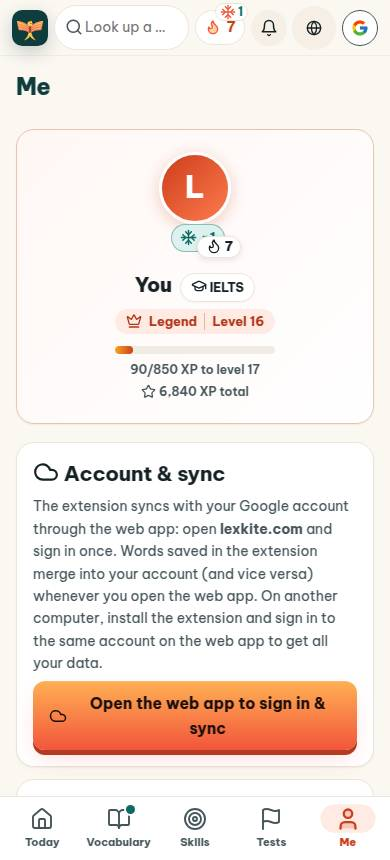
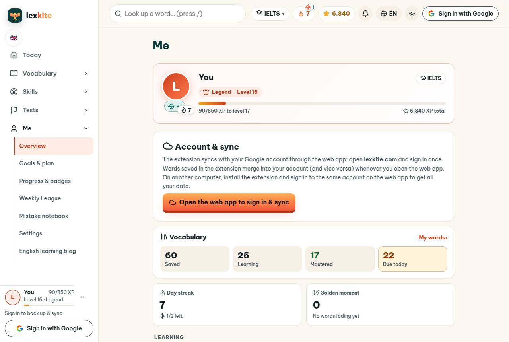
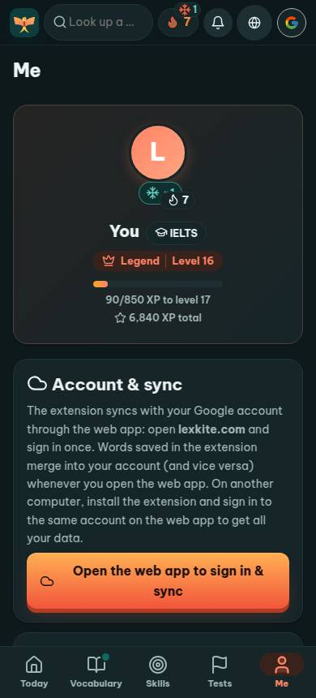
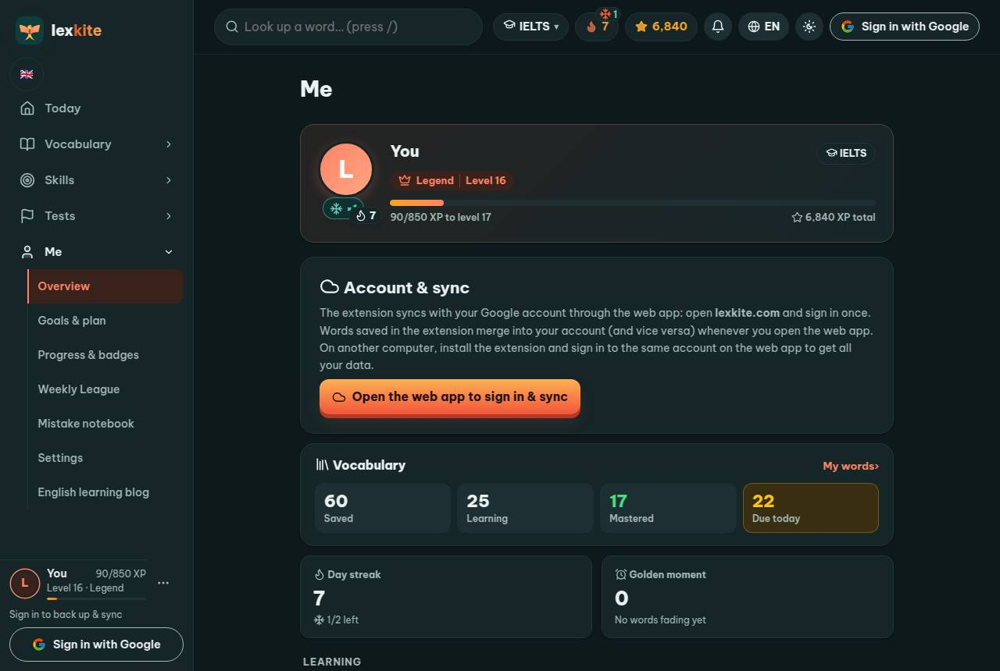

# Add-on › app #/me

Điểm: **94** · độ phủ 68 % · app/index.html?demo=1&hl=en#/me

- Chức năng: 100
- Lỗi JS: 100
- Rỗng/lỗi/tải: ∅
- Back/Thoát: ∅
- Tương phản: 100
- Chạm ≥44: 60
- Bố cục: 100
- i18n 15: ∅
- Hiệu năng: ∅
- Độ đẹp: 82

## Lỗi
- [tap] div.main>header.topbar>a.brand – "" vùng chạm 36×36 < 44px
- [tap] button#avatarBtn – "Sign in with Google" vùng chạm 36×36 < 44px
- [tap] div.card.me-head>div.me-avatar-wrap>button.streak-freeze-badge – "×1" vùng chạm 53×28 < 44px
- [tap] button#examChip – "IELTS ▾" vùng chạm 97×36 < 44px
- [tap] button#langBtn – "EN" vùng chạm 65×36 < 44px
- [beauty] Avatar badge overlaps the main circle awkwardly, breaking alignment rhythm.
- [beauty] Wall of text in Account & sync card lacks visual hierarchy
- [beauty] Top navigation bar icons feel crowded and cluttered

## Ảnh
390l 
1280l 
390d 
1280d 
