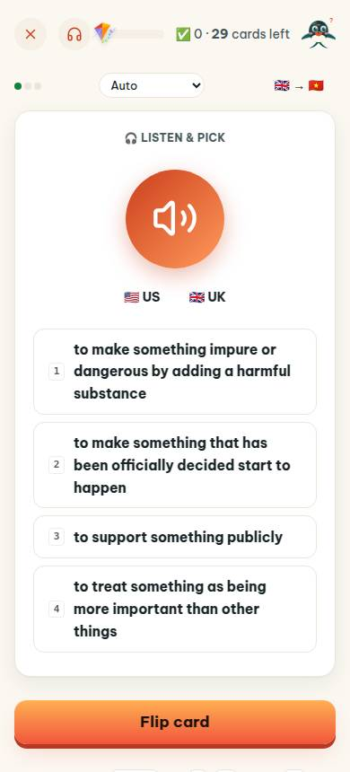
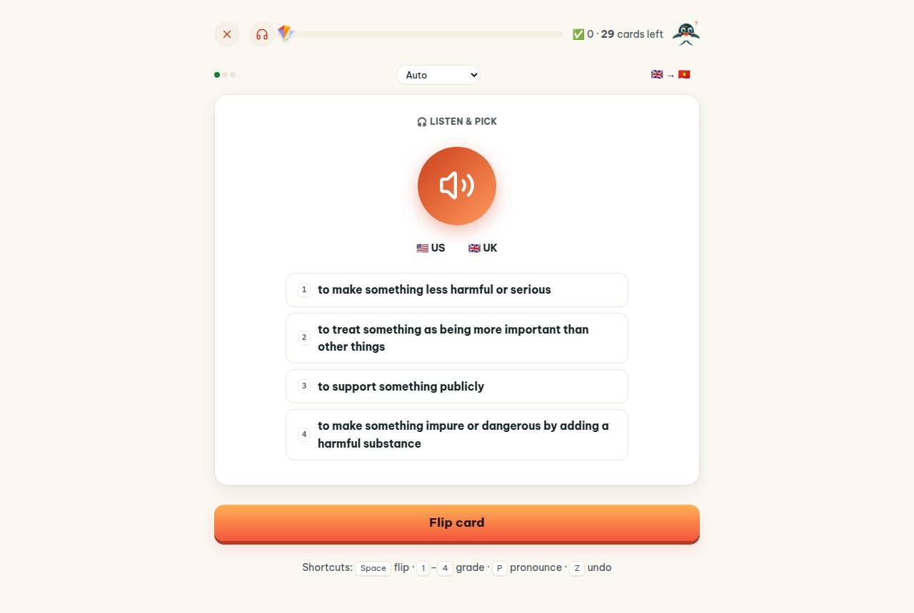
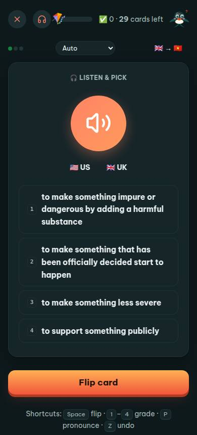
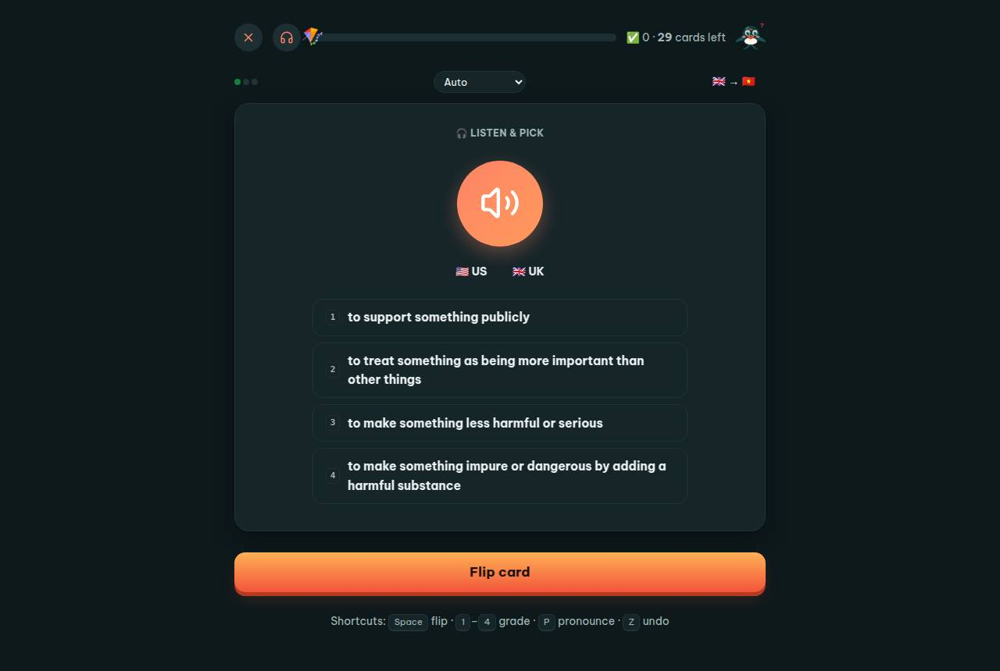

# Add-on › app #/review

Điểm: **92** · độ phủ 68 % · app/index.html?demo=1&hl=en#/review

- Chức năng: 100
- Lỗi JS: 100
- Rỗng/lỗi/tải: ∅
- Back/Thoát: ∅
- Tương phản: 100
- Chạm ≥44: 76
- Bố cục: 85
- i18n 15: ∅
- Hiệu năng: ∅
- Độ đẹp: 79

## Lỗi
- [tap] select#rmSel – "Auto Flip card Type it Listen & pick" vùng chạm 118×28 < 44px
- [tap] button#toggleRev – "🇬🇧 → 🇻🇳" vùng chạm 81×36 < 44px
- [tap] div.card.face>div.row.center>button.btn.sm – "🇺🇸 US" vùng chạm 66×36 < 44px
- [layout] div.study-wrap>p.muted.tiny>span.kbd – nhãn "Z" đứng trơ một mình cả hàng (khung 358px)
- [beauty] Top toolbar icons feel cramped and low-contrast.
- [beauty] Option cards have uneven text lengths, breaking rhythm.
- [beauty] Header controls (Auto, flags) look generic vs. Duolingo polish.

## Ảnh
390l 
1280l 
390d 
1280d 
