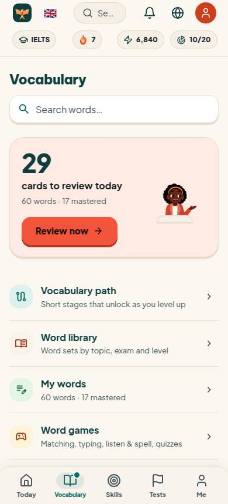
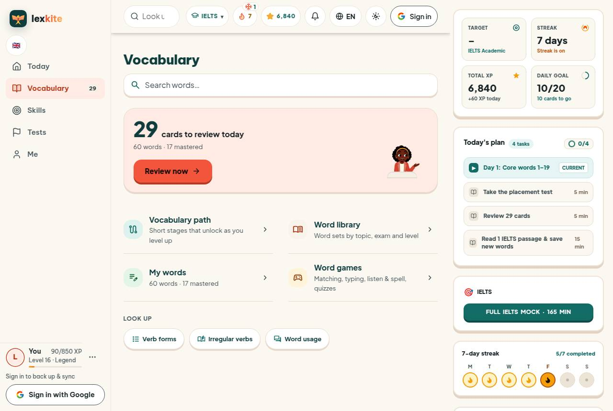
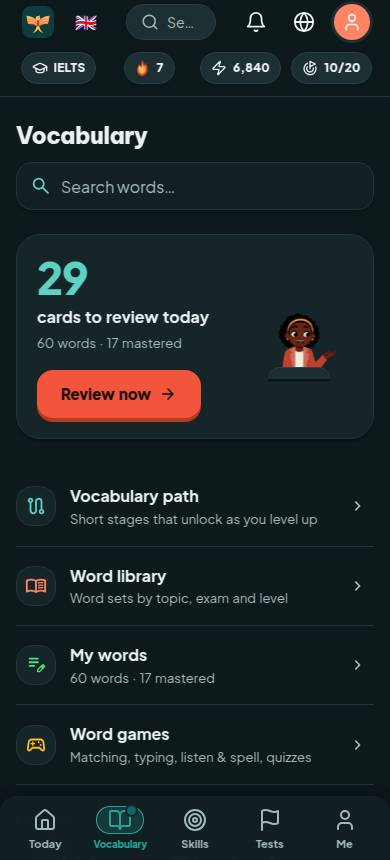
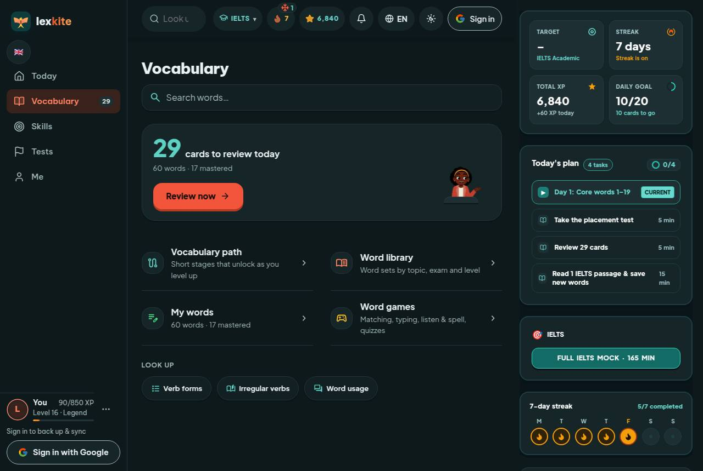

# Add-on › app #/vocab

Điểm: **99** · độ phủ 55 % · app/index.html?demo=1&hl=en#/vocab

- Chức năng: 100
- Lỗi JS: 100
- Rỗng/lỗi/tải: ∅
- Back/Thoát: ∅
- Tương phản: 100
- Chạm ≥44: 100
- Bố cục: 96
- i18n 15: ∅
- Hiệu năng: ∅
- Độ đẹp: ∅

## Lỗi
- [layout] button.hb-s>span>em – chữ bị cắt "…" (100>34px)

## Ảnh
390l 
1280l 
390d 
1280d 
