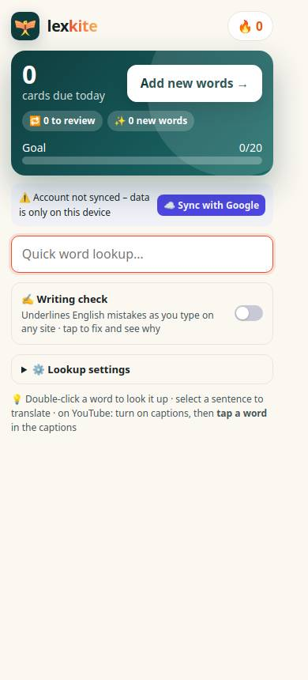
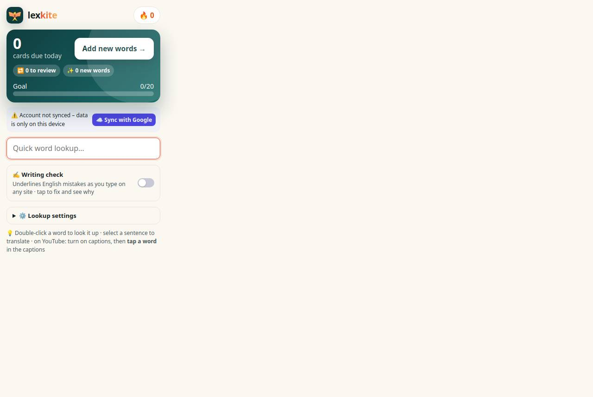
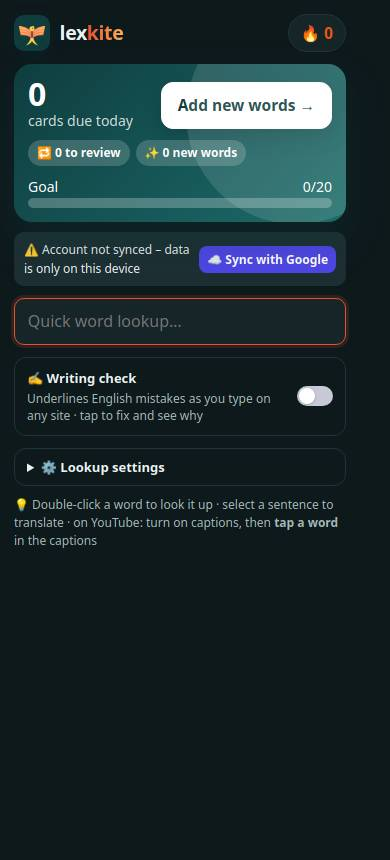
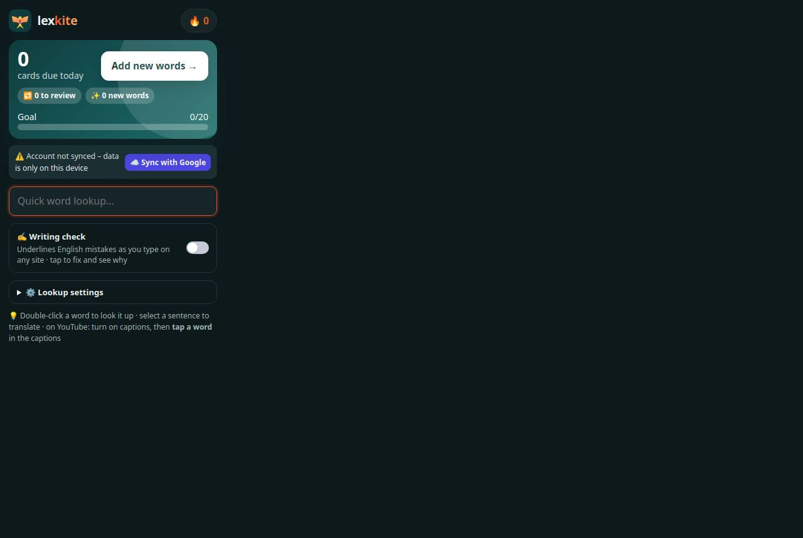

# Add-on › popup

Điểm: **90** · độ phủ 71 % · popup.html

- Chức năng: 100
- Lỗi JS: 100
- Rỗng/lỗi/tải: ∅
- Back/Thoát: –
- Tương phản: 90
- Chạm ≥44: 84
- Bố cục: 85
- i18n 15: ∅
- Hiệu năng: ∅
- Độ đẹp: 72

## Lỗi
- [contrast] #streak
- [tap] a#syncNow – "☁️ Sync with Google" vùng chạm 137×27 < 44px
- [tap] details.pp-set>summary – "⚙️ Lookup settings" vùng chạm 306×21 < 44px
- [layout] div.card.hero-main – nội dung tràn ngang 60px bị cắt
- [beauty] Generic, flat UI lacks Duolingo's playful character integration
- [beauty] Visual hierarchy is weak; primary action is ambiguous
- [beauty] Layout feels sparse and utilitarian, not polished

## Ảnh
390l 
1280l 
390d 
1280d 
