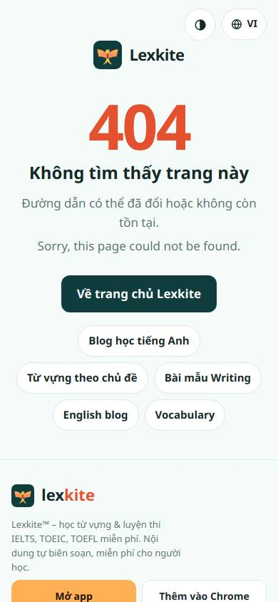
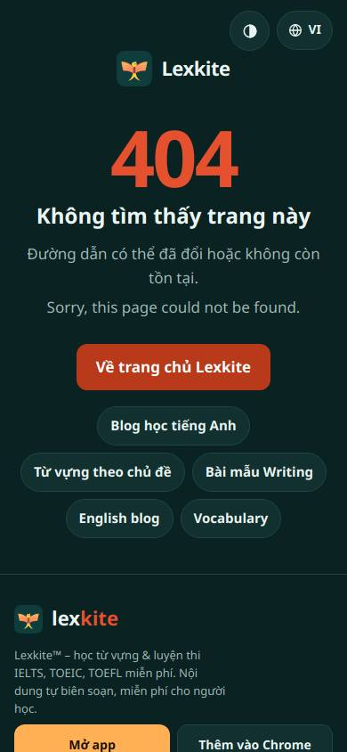
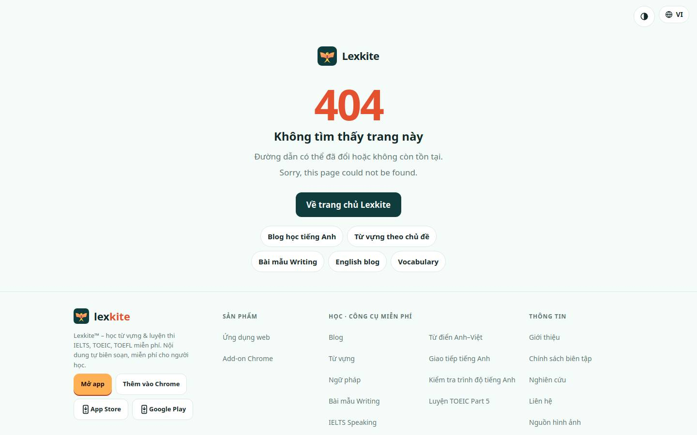
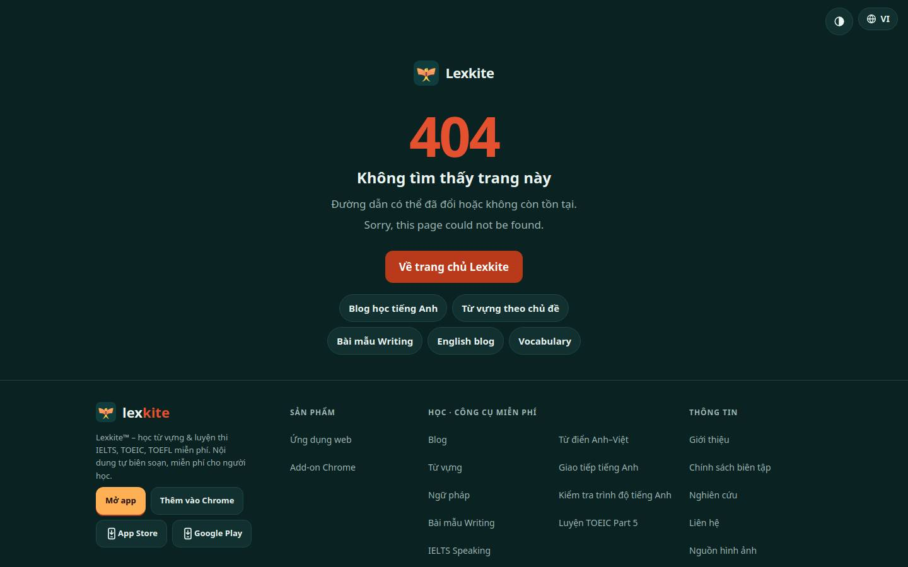

# /404.html

Điểm: **99** · độ phủ 74 % · /404.html

- Chức năng: 100
- Lỗi JS: 100
- Rỗng/lỗi/tải: –
- Back/Thoát: –
- Tương phản: 100
- Chạm ≥44: 84
- Bố cục: 100
- i18n 15: ∅
- Hiệu năng: 100
- Độ đẹp: ∅

## Lỗi
- [tap] div.top>div.lsw>button.lsw-b – "VI" vùng chạm 63×36 < 44px
- [tap] main>a.logo – "Lexkite" vùng chạm 127×40 < 44px

## Ảnh
390l 
390d 
1440l 
1440d 
