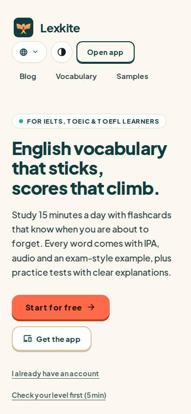
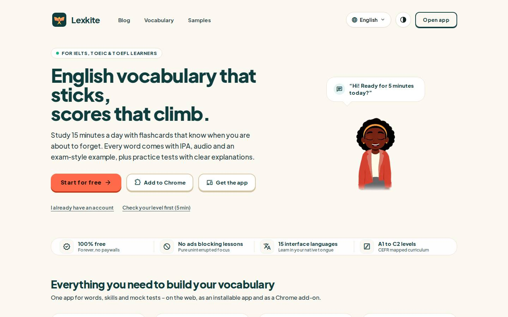

# /L/*/

Điểm: **99** · độ phủ 84 % · /en/words/

- Chức năng: 100
- Lỗi JS: 100
- Rỗng/lỗi/tải: –
- Back/Thoát: –
- Tương phản: 100
- Chạm ≥44: 84
- Bố cục: 100
- i18n 15: 100
- Hiệu năng: 96
- Độ đẹp: ∅

## Lỗi
- [tap] ul.az>li>a – "detrimental" vùng chạm 84×19 < 44px
- [tap] article.page>p.golink>a – "Learn your first English words in 60 sec" vùng chạm 355×19 < 44px

## Ảnh
390l 
390d 
1440l 
1440d 
