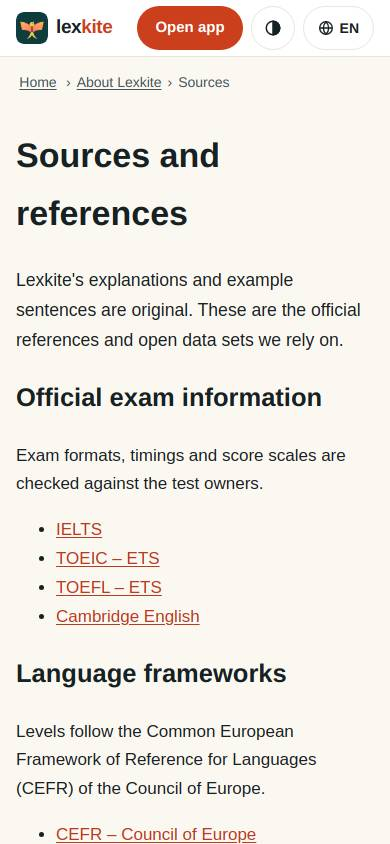
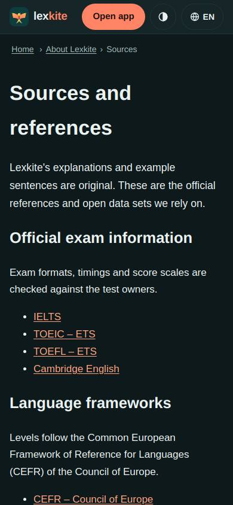
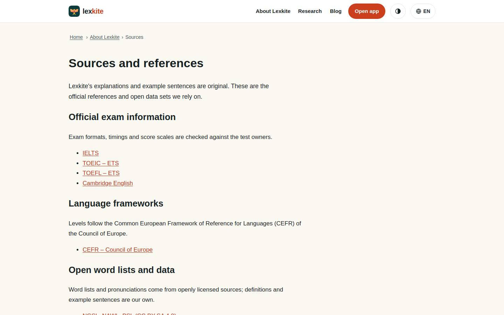
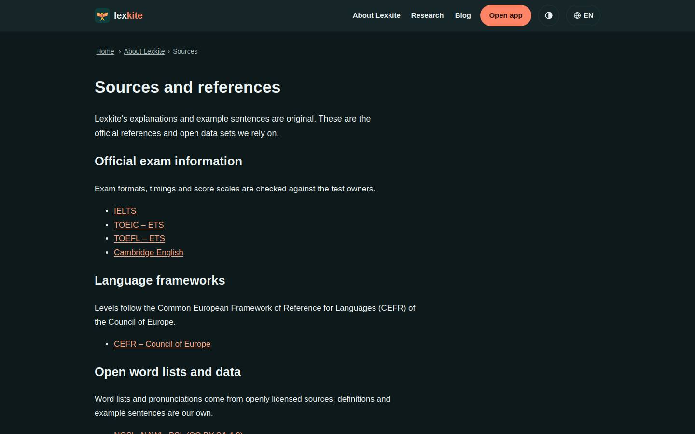

# /L/about/*/

Điểm: **94** · độ phủ 100 % · /en/about/sources/

- Chức năng: 100
- Lỗi JS: 100
- Rỗng/lỗi/tải: –
- Back/Thoát: –
- Tương phản: 100
- Chạm ≥44: 92
- Bố cục: 100
- i18n 15: 100
- Hiệu năng: 100
- Độ đẹp: 64

## Lỗi
- [tap] ul>li>a – "IELTS" vùng chạm 46×19 < 44px
- [beauty] Generic web layout, not app-like
- [beauty] No illustration or character integration
- [beauty] Plain text list lacks visual polish

## Ảnh
390l 
390d 
1440l 
1440d 
